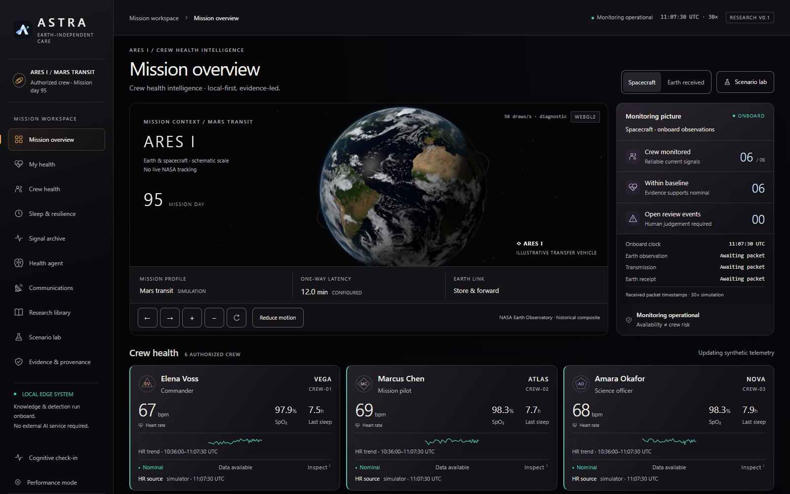
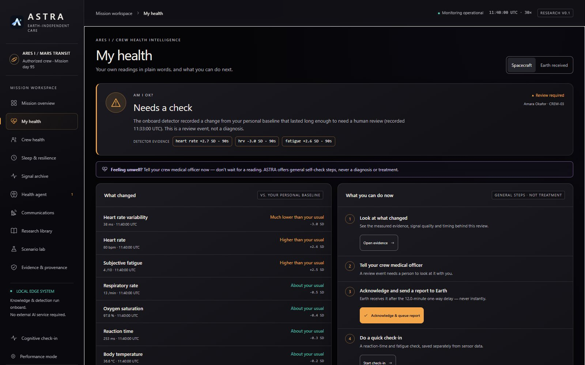
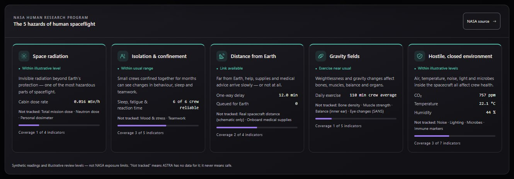
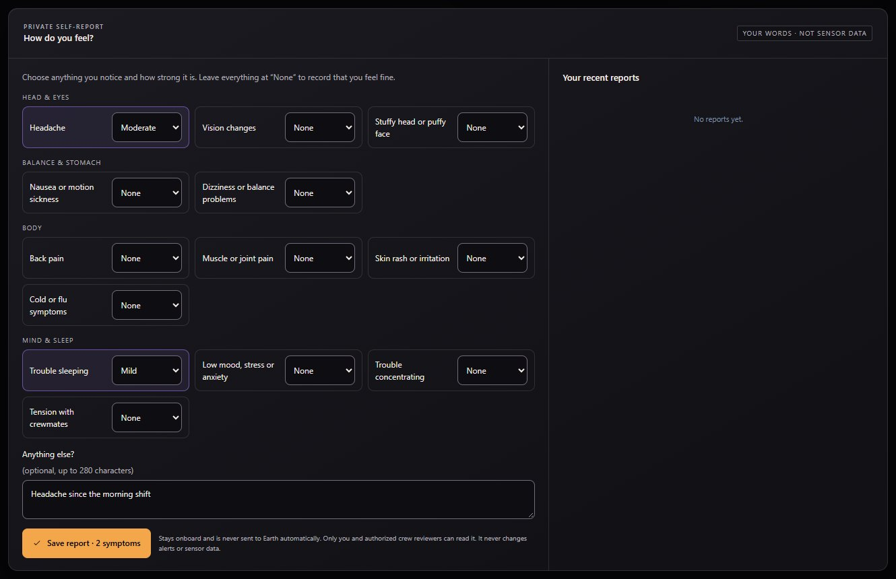
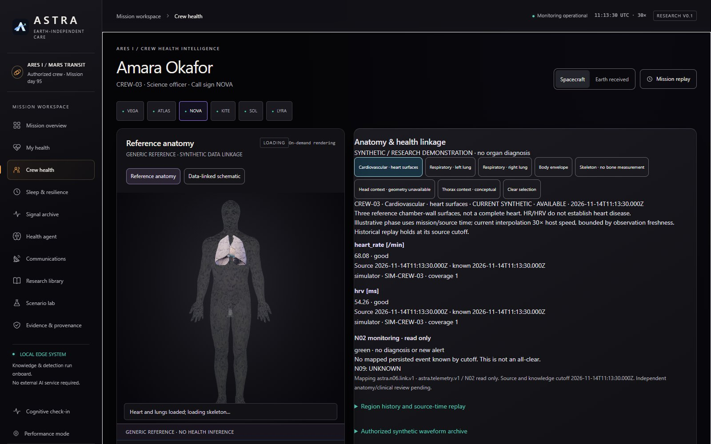
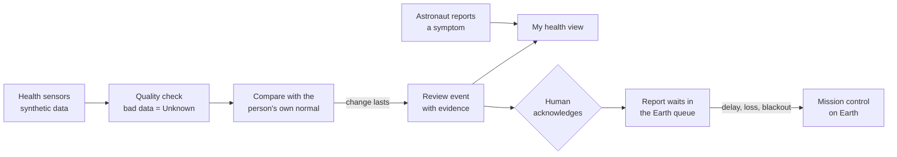

# ASTRA — Earth-Independent Care Platform

**NASA Space Apps Challenge 2026 · Challenge: _Create Health Monitoring Software for Astronauts on Space Missions_**

ASTRA is a health-monitoring app for astronauts on long missions, such as a trip to Mars. It watches each crew member's health signs, notices when something changes, explains it in plain words, and helps the crew decide what to do — **even when Earth is too far away to help quickly.**

> ⚠️ **Research prototype.** ASTRA is not a medical device and is not approved or certified by NASA. All six crew members and all of their health data are **fictional and computer-generated** (synthetic). No real astronaut data is used.



---

## The problem, in simple words

On the International Space Station, doctors on Earth can talk to astronauts almost instantly. On the way to Mars it is different:

- A message to Earth can take **up to about 22 minutes one way**, and sometimes the link is **cut off completely** (for example, when the Sun is between Earth and Mars).
- So astronauts must be able to **notice, understand and act on changes in their own health by themselves**.
- Space itself is hard on the body. NASA lists five big hazards: **radiation, isolation and confinement, distance from Earth, changing gravity, and a closed, hostile environment.**

ASTRA is our answer: a crew health assistant that works **fully offline**, onboard the spacecraft.

---

## What ASTRA does

| Feature | What it means in simple words |
|---|---|
| **Mission overview** | One screen showing all six crew members, their health status, a 3D Earth, the spacecraft's link to Earth, and NASA's five space hazards. |
| **"My health" (astronaut self-view)** | Each astronaut sees three answers in plain words: **Am I OK? What changed? What can I do now?** |
| **Personal "normal"** | ASTRA learns what is normal for *each person* (for example, *your* usual heart rate), instead of comparing everyone to one average. |
| **Change detection** | If a reading stays away from a person's normal for a while, ASTRA raises a "needs a check" event with the evidence behind it. |
| **Honest "Unknown"** | If a sensor is missing, broken or out of date, ASTRA shows **gray / Unknown** — it never pretends the person is fine. |
| **Symptom self-report** | Sensors can't feel a headache or low mood, so astronauts can report 13 symptoms (mild / moderate / severe). Each is linked to a NASA health risk. Reports stay private and onboard. |
| **Human in charge** | A person must **acknowledge** an event before any report is sent to Earth. The app never diagnoses or prescribes treatment. |
| **Delayed link to Earth** | Reports wait in a queue and travel to Earth with a realistic delay, packet loss and blackouts. Nothing is lost if the app restarts. |
| **Crew health & 3D body** | Trend charts, the evidence behind each event, a 3D reference human body, and a schematic "twin" whose heart and lungs move with the measured heart and breathing rates. |
| **Sleep, check-ins, signal archive** | Sleep records, a quick reaction-time and fatigue check-in, and replay of recorded body signals (waveforms). |
| **Onboard research library** | 29 short, cited summaries of NASA research about astronaut health, searchable **without internet**. It refuses unsafe medical questions and says so when it doesn't know. |
| **Scenario lab** | Ready-made test stories (sleep debt, heart and breathing changes, a radiation spike, a sensor failure, an Earth-link blackout, and more) to show how ASTRA reacts. |
| **Roles & privacy** | Seven demo roles (astronaut, flight surgeon, mission control, researcher and others). Astronauts only see their own records. Every important action is written to a tamper-evident audit log. |

<table>
<tr>
<td width="50%"><br><sub><b>My health</b> — "Am I OK?", what changed, and next steps</sub></td>
<td width="50%"><br><sub><b>NASA's five hazards</b> — what ASTRA tracks, and honestly what it does not</sub></td>
</tr>
<tr>
<td width="50%"><br><sub><b>Symptom self-report</b> — linked to NASA Human Research Program risks</sub></td>
<td width="50%"><br><sub><b>Crew health</b> — trends, evidence and the 3D body</sub></td>
</tr>
</table>

---

## How it works



1. **Gather** — ten health signs per astronaut: heart rate, heart-rate variability, oxygen level, breathing rate, body temperature, last sleep, fatigue, reaction time, daily exercise and radiation dose rate.
2. **Check quality** — readings that are missing, old or unreliable become **Unknown** (gray).
3. **Compare with the person's own normal** — ASTRA builds each person's baseline from 720 calibration readings per health sign, using robust statistics (median and MAD) that are not fooled by a few odd values.
4. **Wait before alarming** — one strange reading is not enough. The change must last for a while, or several signs must change together. Exercise is taken into account.
5. **Explain and act** — the astronaut sees plain-language next steps, a person acknowledges the event, and only then is a report queued for Earth.

The decisions are made by **simple, testable rules — not by an AI chatbot.**

---

## Tech stack

| Part | What we used | Why |
|---|---|---|
| Server | **Node.js 24** (built-in HTTP server) | One small program runs everything. No cloud needed. |
| Database | **SQLite** (built into Node.js) | Stores data in one local file, so it works offline and survives restarts. |
| Front end | **Plain JavaScript (ES modules), HTML and CSS** | Runs in any modern browser with no build step. |
| 3D Earth and body twin | **WebGL2** with custom shaders | Fast, smooth graphics that work without internet. |
| 3D anatomy viewer | **Three.js 0.186.1** (included in the repo) | Shows the BodyParts3D reference human body. |
| Live updates | **Server-Sent Events** | The screen updates every second without reloading. |
| Security | HttpOnly sessions, server-side permissions, hash-chained audit log | Every permission is checked on the server, not in the browser. |
| Testing | **Node.js test runner** + real Chrome browser checks | More than 580 automated tests. |

**No API keys, no paid services and no internet connection are needed to run ASTRA.**

---

## NASA resources used

| NASA resource | How ASTRA uses it |
|---|---|
| [NASA Human Research Program — Hazards of Human Spaceflight](https://www.nasa.gov/hrp/hazards/) | The five-hazards panel on the mission overview. |
| [NASA Human Research Program — Human Health Risks](https://www.nasa.gov/hrp/risks/) | Links each symptom to a NASA risk, and powers most research-library entries (for example eye changes (SANS), bone loss, immune changes, balance changes, sleep and teamwork). |
| [NASA Human Research Program — Ongoing Research](https://www.nasa.gov/hrp/ongoing-hrp-research/) | Research-library summaries about current ISS and Artemis studies. |
| [HRP evidence report on sleep loss, circadian desynchronization and work overload (NTRS 20160003864)](https://ntrs.nasa.gov/citations/20160003864) | Stored offline as a research document with page-level citations. |
| [NASA-STD-3001 Volume 2 — Human Factors, Habitability and Environmental Health](https://www.nasa.gov/reference/nasa-std-3001v2/) | Stored offline as a research document with page-level citations. |
| [NASA-STD-3001 Volume 1 — Crew Health](https://www.nasa.gov/reference/nasa-std-3001v1/) | Background for crew-health requirements. |
| [Exploration Medical Capability (ExMC) — clinical decision support architecture](https://ntrs.nasa.gov/citations/20220017869) | Shaped ASTRA's design: onboard decision support with humans in charge. |
| [Earth Independent Medical Operations (EIMO)](https://ntrs.nasa.gov/citations/20240000914) | The core idea of ASTRA: care that does not depend on Earth. |
| [Exploration Electronic Health Record (xEHR)](https://ntrs.nasa.gov/citations/20230003216) | Shaped how ASTRA keeps health records and evidence. |
| [NASA Open Science Data Repository (OSDR)](https://science.nasa.gov/biological-physical/data/osdr/) | Research context and public study metadata. |
| [NASA Earth Observatory — Blue Marble](https://science.nasa.gov/earth/earth-observatory/blue-marble-next-generation/base-map/) and [Blue Marble cloud imagery](https://science.nasa.gov/earth/earth-observatory/the-blue-marble-true-color-global-imagery-at-1km-resolution/) | The day and cloud textures of the 3D Earth (credit: NASA Earth Observatory / Goddard Space Flight Center, Reto Stöckli, Robert Simmon). |

**Partner and other sources:** Canadian Space Agency pages on [radiation monitoring (CANS)](https://www.asc-csa.gc.ca/eng/news/articles/2026/2026-02-26-monitoring-radiation-astronaut-health.asp) and [why science is done in space](https://www.asc-csa.gc.ca/eng/iss/science/why-do-we-conduct-science-experiments-in-space.asp), the [PhysioNet BIDMC dataset](https://physionet.org/content/bidmc/1.0.0/), and the [NIST AI Risk Management Framework](https://www.nist.gov/publications/artificial-intelligence-risk-management-framework-ai-rmf-10).

Real astronaut health data is not public, so the crew data in ASTRA is synthetic. Every generated reading is labelled with its random seed, scenario and generator version. Using NASA material does not mean NASA endorses this project.

---

## Run it on your computer

**You need:** [Node.js](https://nodejs.org/) **version 24.21 or newer (24.x)** and Git. Nothing else — no `npm install`, no API keys.

```bash
git clone https://github.com/asjadkashif2004/Astra---Earth-Independent-Care-Platform-Nasa-Space-App-Challenges.git astra
cd astra
npm start
```

Then open **http://localhost:3000** in Chrome, Edge or Firefox, pick a demo role (start with **Astronaut** or **Demo administrator**) and enter the mission.

- **Stop:** press `Ctrl + C` in the terminal.
- **Start fresh:** stop the app and delete the `data/runtime` folder. ASTRA makes a new database next time it starts.
- **Real-time clock:** by default the mission clock runs 30× faster so you can see changes quickly. For real time:
  - PowerShell: `$env:ASTRA_SPEED=1; npm start`
  - Command Prompt: `set ASTRA_SPEED=1 && npm start`
  - macOS / Linux: `ASTRA_SPEED=1 npm start`
- **Windows tip:** a few file paths in this repo are long. If cloning gives a "Filename too long" error, clone into a short folder such as `C:\astra`, or run `git clone -c core.longpaths=true …`.

### A 3-minute demo to try

1. Log in as **Demo administrator**. The **Mission overview** shows the six crew members and NASA's five hazards.
2. Open **Scenario lab** and start a scenario for one crew member, such as a heart and breathing change.
3. Open **My health** and choose that crew member — it now says **"Needs a check"**, shows what changed, and lists next steps.
4. Report a symptom (for example, a headache) in the symptom form on the same page.
5. Acknowledge the event in **Health agent**, then open **Communications** and watch the report wait in the queue and arrive on Earth after the delay.
6. Log out and log in as **Astronaut** to see what a single crew member sees: only their own health.

A step-by-step guide with screenshots (in Roman Urdu) is in [docs/demo/ASTRA_Demo_Guide_Roman_Urdu.pdf](docs/demo/ASTRA_Demo_Guide_Roman_Urdu.pdf).

### Put it online for free (Render)

The repository includes a [render.yaml](render.yaml) Blueprint. Sign in to [render.com](https://render.com) with GitHub, click **New + → Blueprint**, pick this repository and click **Deploy Blueprint**. The free web service needs no credit card. Everyone with the link shares one fictional mission, it sleeps after about 15 minutes without visitors, and it starts fresh on every restart. Full step-by-step guide: [docs/DEPLOY_RENDER.md](docs/DEPLOY_RENDER.md).

### Run the tests

```bash
npm run check
node --test --test-isolation=none tests/foundation.test.mjs tests/integration.test.mjs tests/web.test.mjs tests/frontend-correctness.test.mjs tests/self-health.test.mjs tests/symptom-report.test.mjs tests/research-library.test.mjs tests/anatomy-linkage-ui.test.mjs tests/sleep-lifecycle.test.mjs tests/public-demo.test.mjs
```

The first command checks every JavaScript file. The second runs the core tests (89 tests, about a minute); GitHub Actions runs the same set on every push. The full `npm test` suite also includes long native-runtime experiments that need extra local setup, so use the commands above for a quick check.

---

## What is in this repository

| Folder | What's inside |
|---|---|
| `apps/mission-control-web/` | The app you see in the browser: screens, 3D Earth, anatomy viewer, styles. |
| `services/api/` | The server: database, logins and permissions, health-change detection, API. |
| `services/` (other folders) | Telemetry simulator, Earth-link queue, research search, sleep, waveforms, forecasts. |
| `packages/` | Shared rules and data definitions, plus the original BodyParts3D anatomy files. |
| `knowledge/` | The research-library source list (29 cited summaries). |
| `data/` | Public dataset metadata and the offline NASA research documents. |
| `docs/` | Documentation, the demo guide, screenshots and the Space Apps submission text. |
| `tests/`, `scripts/` | Automated tests and helper scripts. |
| `artifacts/` | Text evidence from earlier test runs (reports, checklists, results). |
| `research/` | The original research specification for the project. |

**Left out on purpose** (see [.gitignore](.gitignore)): the private runtime database (`data/runtime/`), any `.env` secret files, `node_modules/`, and about 9 GB of local test leftovers (test databases, screenshots, archives and a portable Node.js program). None of these are needed to run ASTRA.

---

## Limitations (being honest)

- All crew members and all health data are **fictional and synthetic**. ASTRA has not been tested with real astronauts or real wearable devices.
- Review levels are for demonstration only. They are **not** NASA medical limits.
- Not tracked yet: total radiation dose, neutron dose, bone density, muscle strength, balance, eye changes and immune markers. Connecting real wearables and these measurements is the next step.
- The demo login lets you pick any role. That is fine on your own computer, but a real public service would need real logins first, so the server only listens on your own machine (`127.0.0.1`) by default. The optional shared public demo mode (used for Render) must be switched on on purpose and is meant only for fictional data.

## Use of AI

- An AI coding assistant (Claude by Anthropic) helped write code, tests and documentation. Our team directed and reviewed the work.
- **Inside the app, no AI makes health decisions.** Alerts come from simple, testable statistics; reports use fixed templates; the research library uses keyword search with citations. A small local language model was tried in separate research experiments but is **switched off**.

## Credits and licences

- **3D Earth:** NASA Earth Observatory / NASA Goddard Space Flight Center — Blue Marble Next Generation (Reto Stöckli) and Blue Marble cloud composite (Reto Stöckli, Robert Simmon). Details: [assets/earth/README.md](apps/mission-control-web/assets/earth/README.md).
- **3D anatomy:** BodyParts3D, © 2008 The Database Center for Life Science, licensed under [CC Attribution-Share Alike 2.1 Japan](https://creativecommons.org/licenses/by-sa/2.1/jp/). The meshes in this repo are derived from it and keep the same licence. It is a generic adult reference body, not a model of any astronaut. Details: [assets/anatomy/attribution.json](apps/mission-control-web/assets/anatomy/attribution.json).
- **Three.js** 0.186.1 — MIT licence.
- A project-wide open-source licence has not been chosen yet. Third-party material keeps its own licence.

## More documentation

[Architecture](docs/ARCHITECTURE.md) · [Requirements](docs/REQUIREMENTS.md) · [Setup](docs/SETUP.md) · [Testing](docs/TESTING.md) · [Known limitations](docs/LIMITATIONS.md) · [Feature audit](docs/FEATURE_AUDIT.md) · [Module tracker](docs/MODULE_TRACKER.md) · [Presentation guide](docs/ASTRA_FINAL_DEMO_READINESS.md) · [Space Apps submission text](docs/submission/SPACE_APPS_SUBMISSION.md)
