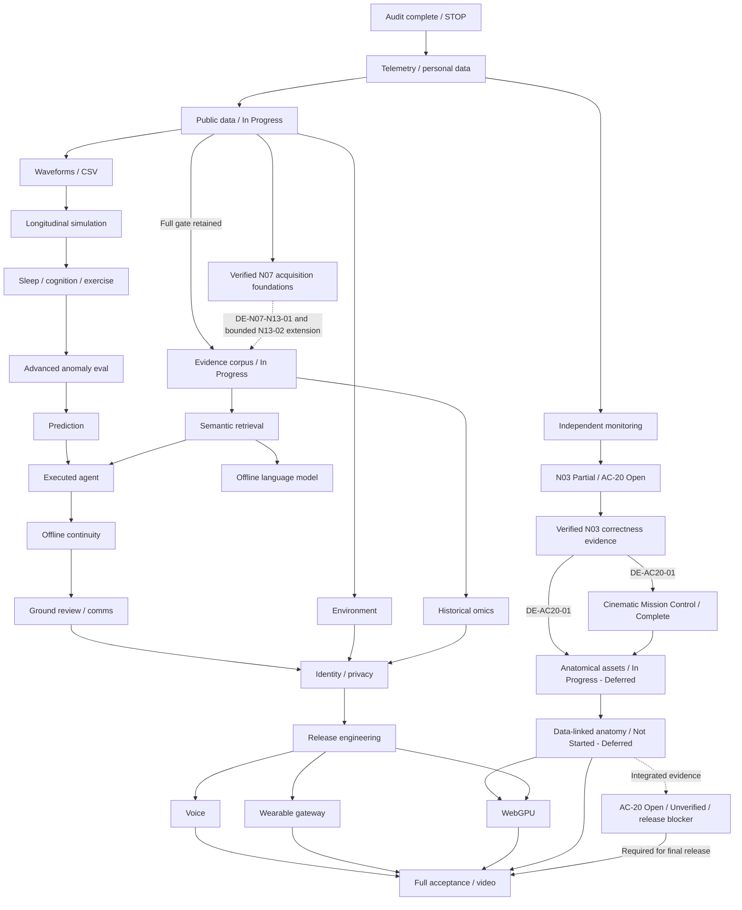
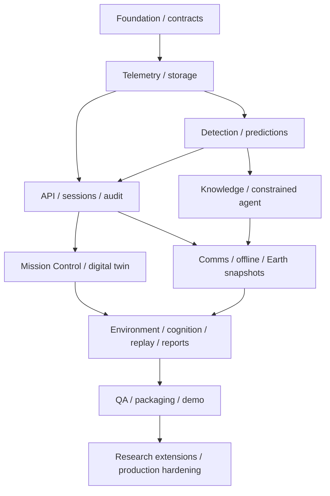

# ASTRA controlled development roadmap

## N10 master mission —2026-10-30; implementation dependency-blocked / STOP

[Report](N10_MASTER_COMPLETION_REPORT.md) maps exact sleep/cognition/countermeasure requirements and interfaces. No active N10 exception covers N03 Partial or unfinished N07/N09; conditional owner approval preserves these gates. Only read-only audit, existing isolated QA and one QA-loader repair completed. Initial174/176passes, affected47/47rerun and129unchanged passes cover176distinct baseline checks; no N10 feature/browser acceptance. [Proposal](DE_N10_SYNTHETIC_01.md) inactive. N10 Not Started/dependency-blocked; all other statuses/prerequisites/reviews and N16 evidence unchanged. No automatic implementation or next module.

## N16 final authorized engineering —2026-10-30; COMPLETE scope, formal module In Progress / STOP

[Comprehensive report](N16_MASTER_COMPLETION_REPORT.md): narrow fixed-statement authorizer repair,4/4actual designated-source SQL tools, one risk-first coordinator/18events, zero-replay cold recovery and standalone recorded Health Agent demo.583focused tests pass,4fresh starts within6, source/old evidence/operational application preserved. Prior closed latch and G INCONCLUSIVE remain unchanged. No operational integration, LLM, prerequisite/review waiver or full N16 closure. Original broader graph/metrics/browser and N10/N12/N14/conditional N15/transitive/scientific requirements remain. Current permission expires; STOP.

## Consolidated N16 engineering mission —2026-10-29; PARTIAL / native authorization STOP

[Master report](N16_MASTER_COMPLETION_REPORT.md)/[completion matrix](N16_MASTER_CONTRACT.md): three designated-source tools qualified, actual sequential coordinator and zero-replay committed recovery, isolated saved presentation.5native starts/2risk failures; second risk step triggers a repeated SELECT authorization callback and the unchanged strict guard denies SQLite23. Campaign latch closed, no unused resources/startups remain.519final focused QA passes/clean syntax; original source/query/app/evidence intact, G INCONCLUSIVE unchanged. No exception expansion, Health Agent integration, model work, review or prerequisite closure. N16 stays In Progress; risk authorization compatibility and original full graph/dependency/browser/scientific gates remain. STOP after consolidated report.

## N16-06H — journal QA correction; no execution authority / STOP

[Completion](N16_06H_COMPLETION.md) delivers37mock/disposable-JSONL controls/three syntax checks and a parent-only serialized journal/reconciliation barrier in the quality controller. No native/SQLite/SQL/source-byte/mount/network actions or exception/resource renewal. Historical G remains INCONCLUSIVE, exact loss cause unconfirmed; source/worker/query/authorization/containment/full prerequisites preserved.586other protected hashes/all106table rows unchanged. No statuses or scientific/medical gates close. Exactly one next proposal: separately approved fresh get_data_quality single-read qualification with new output/pins/one-start resources; no remaining tools or automatic replay. STOP after H.

## N16-06G — audited INCONCLUSIVE; one startup consumed; STOP

[Completion](N16_06G_COMPLETION.md), [audit](../artifacts/n16-06g-20261029/audited-outcome.json):140mock controls/seven syntax checks passed. One genuine get_data_quality SELECT/readonly connection/exit0 returned canonical CREW-03 heart_rate quality, value null; source before/after integrity and six-event result recovery/replay0 pass. Full qualification withheld:7samples reported but5resource rows persisted; raw controller PASS and original journal retained, exact cause unresolved/no ceiling breach inferred. No post-run repair/retry or other tool.526old hashes and all status/dependency rows preserved. G permission expires. Exactly one next proposal: QA-only journal serialization/count reconciliation repair, no SQL/source/worker/resource renewal. All statuses/scientific/full gates unchanged; N16 In Progress. STOP.

## N16-06F one designated-source SELECT — 2026-10-29; bounded PASS / STOP

[Completion](N16_06F_COMPLETION.md), [safety contract](N16_06F_CONTRACT.md): explicit task-only mode in existing worker replaces setup/metadata/transaction SQL with pinned sealed-source/schema binding, restrictive authorizer, ro mounts/connection and durable ACK. Old workflow/frozen block unchanged; parent worker pin alone updated.108mock passes/seven syntax checks; exactly one native startup/read-only connection/SELECT, exit0, CREW-03 HR103/min KNOWN at archived as_of. Actual source full SHA/inventory/instance unchanged; six-event committed trace/fresh-process recovery COMPLETE/replay0.329.563770ms/native worker max57,565,184bytes/max monitored77,602,816/runtime storage5,017,153, cleanup0/network0.475old hashes and authoritative tables preserved; no operational/app/model/N02 change or review closure. Task resources expire. One next proposal only separately approved one-tool get_data_quality single-SELECT qualification/fresh scope/resources, no automatic remaining tools/integration. All statuses/full gates unchanged, N16 In Progress. STOP.

## N16-06E single-SQL preflight — 2026-10-29; BLOCKED /0STARTS / STOP

[Completion](N16_06E_COMPLETION.md): current pinned worker already uses proof-gated EACCES handling, but its frozen SQL block also executes two PRAGMAs, metadata SELECT and BEGIN/ROLLBACK. That cannot satisfy owner's single-observation-SELECT/no-other-SQL restriction through a guard-only correction. Required stop applied before source access/QA/native execution:0startups/SQLite/SQL/committed results, source hash and runtime measurements NOT RUN. No code or guard change;471old hashes/status tables preserved. One next proposal only explicit task-specific single-SELECT worker specialization/setup-contract approval with equivalent safeguards, mock QA and fresh one-start SQL/resources. No automatic four-tool replay or operational integration. All statuses/prerequisites/reviews/full gates unchanged; N16 In Progress. STOP.

## N16-06D single containment probe — 2026-10-29; bounded PASS / STOP

[Completion](N16_06D_COMPLETION.md): fresh owner-only containment authorization,77/77required mock controls/two syntax checks/full preflight pass. Exactly one isolated startup/exit0,216.227228ms; independent stable mountinfo verifies root/source ro, actual open errno root/directory EROFS(-30), source-file EACCES(-13). Durable diagnostic ACK, cleanup0; no database bytes/SQLite/SQL or further qualification. Worker kernel maxRSS53,182,464bytes, max monitored process74,080,256bytes, runtime counted4,914,099bytes; unchanged512MiB/64MiB monitored limits. New task-path-only controller/plan;444old hashes/source metadata/status tables preserved, no existing code or operational/model change. Historical N16-06 remains unsuccessful, not retroactively qualified. Current one-start/resources expire. One next proposal only separately approved single get_current_vitals SQL read on same sealed synthetic source with fresh authority/traces/fail-fast; no automatic four-tool/Health Agent replay. All statuses/prerequisites/reviews/full gates unchanged; N16 In Progress. STOP.

## N16-06C pin-resolver correction — 2026-10-29; QA-only PASS / STOP

[Completion](N16_06C_COMPLETION.md): explicit changed/preserved inventory assignment with immutable manifest digests, duplicate/conflict/stale/mismatch rejection and full code hashing;32/32focused controls/three syntax checks pass. Corrected eight-file code plan is additive; B evidence preserved.426old code/evidence hashes unchanged, sole intended existing-source change is the runner's pin/plan integration. No full preflight, source data/metadata inspection, probe startup, SQLite/SQL, mount/permission, network/model or operational action; no renewed authority or exception change. Real containment remains unverified, N16-06 BLOCKED. Next one separate approval only: fresh single containment-only probe with metadata/resource permission, new durable output records, no DB bytes/SQL/retry. All authoritative statuses/prerequisites/scientific/full/release gates unchanged; N16 In Progress. STOP.

## N16-06B single-probe task stopped at preflight — 2026-10-29

[Completion](N16_06B_COMPLETION.md): owner approved one containment-only startup, but new runner pin-resolution bug rejects an unchanged dependency absent from its changed-files index.45mock controls and source metadata validate; **0probe startups**, no guard/errno/mount evidence, database bytes, SQLite, SQL, source/mount changes or operational/model action. No correction/retry after failure.412protected hashes/table rows preserved; resource targets not expanded or claimed qualified. Current one-time authority expires; next proposal only separately approved QA-only resolver correction with deterministic metadata fixtures. All statuses/prerequisites/independent/full/release gates remain unchanged; N16 In Progress, SQL qualification blocked. STOP.

## N16-06A diagnostic and batch QA repair — 2026-10-29; STOP

[Completion](N16_06A_COMPLETION.md), [contract](N16_06A_CONTRACT.md): owner approved QA-only structured guard diagnostics, independent mount-level assertion/durable acknowledgement and first-failure admission repair.45/45non-SQL mock controls/six syntax checks; complete frozen worker/query block and source/sealing/contract semantics retained. No database bytes, SQL/worker/model/API/network or mount action;384protected hashes unchanged, all authoritative table rows preserved. N16-06 runtime still BLOCKED and expired authority not renewed. No new exception or prerequisite/review closure. Exactly one next proposal only separately approved single containment-only diagnostic probe with fresh resources/source access and no SQL. N16/N15/N14/N13/N07/N09 and all other statuses remain unchanged; STOP after QA.

## N16-06 activation and blocked qualification — 2026-10-29; STOP

Owner explicitly activated [DE-N16-DESIGNATED-READ-01](DE_N16_DESIGNATED_READ_01.md) for one sealed synthetic source only. [Completion](N16_06_COMPLETION.md): donor/copy integrity and manifest pass; source containment guard blocked every native attempt before SQLite.32focused checks16pass/16fail, no successful four-tool SQL qualification; batching continued after first blocking result and must be repaired separately. No operational/model/application changes or authority; original code/contracts/results preserved. Task execution authority exhausted, no native retry. Exactly one next proposal: separately approve QA-only guard diagnostics/read-only mount attestation and fail-fast batch correction with deterministic tests. N16/N15/N14/N13/N07 and all other statuses/gates/table rows unchanged; no independent-review or full-module completion.

## N16-05 designated synthetic source proposed — 2026-10-29; documentation only / STOP

[Completion](N16_05_COMPLETION.md), [source specification](N16_05_SOURCE_DESIGNATION.md) and proposed [DE-N16-DESIGNATED-READ-01](DE_N16_DESIGNATED_READ_01.md) prepare one future sealed archive copy of N16-04's exact elevated synthetic original. Four tools only, trusted role/crew scope, fixed SELECTs, no source sidecars, archive freshness/UNKNOWN and external traces. No active operational source is selected; no database bytes accessed, SQL/preparation/runtime/model/app/code changes or activation. Current source availability/integrity is not newly qualified. Exception and future budgets remain proposed/inactive; existing exceptions and authoritative dependency/status/acceptance table rows unchanged. N16/N15/N14/N13/N07 In Progress; all other statuses, scientific/full/release gates and inactive N15 rule preserved. Next separate approval must activate the new exception and authorize one isolated designated-source qualification, not live access or integration. STOP after planning.

## N16-04 scratch qualification delivered — 2026-10-29; STOP

Owner explicitly activated [DE-N16-SQLITE-FIXTURE-01](DE_N16_SQLITE_FIXTURE_01.md) and authorized one bounded scratch-only continuation. [Completion](N16_04_COMPLETION.md): four genuine read-only SQL tools, separate synthetic builder/writer, controlled WAL/checkpoint qualification and durable18-event recovery without replay;35/35 focused checks/five syntax checks. Selected prior sources/evidence and frozen originals preserved. All qualification is isolated synthetic Linux scratch, with explicit monitored-resource limits; no operational DB/API, live dispatcher, Health Agent/model integration, N02 changes or independent review claims. N16 remains In Progress, original dependencies/acceptance unchanged. Authority exhausted; one next proposal only is separate documentation of a designated synthetic operational-read exception/plan without activating access. N15/N14/N13/N07 and all other statuses/gates remain unchanged. Prior preflight entries are historical.

## N16-04 governance preflight — 2026-10-28; held before implementation

The owner conditionally approved scratch-only SQLite qualification, with an explicit stop for any required separate exception. [Preflight](N16_04_PREFLIGHT.md) identifies a new database-construction/concurrent-writer capability beyond DE-N16-READONLY-01's trace-only write scope. [DE-N16-SQLITE-FIXTURE-01](DE_N16_SQLITE_FIXTURE_01.md) is proposed/inactive; existing exception/contracts remain unchanged. No database, SQL, tool, model, code/QA or operational work started. N16/N15 and all other statuses/direct/transitive/scientific/release gates retained. Only next decision: explicit scratch-only exception activation/resumption; no operational-read authority. STOP before implementation.

## N16-03 operational-read readiness review — 2026-10-28; planning only / STOP

[Review](N16_03_OPERATIONAL_READINESS.md) maps constructor/GET side effects, canonical source surfaces, trusted identity/source scope and conditional SQLite/WAL isolation. No operational database/API/tool/model access or implementation. DE-N16-READONLY-01 is unmodified and grants no operational connection; full N02/N10/N12/N14 and conditional N15/transitive/scientific/release gates remain. One proposed next implementation is isolated four-tool SQLite-reader qualification on fresh synthetic scratch WAL fixtures, requiring separate scope/implementation approval; no operational source authority follows from it. N16/N15 and all other statuses remain unchanged; STOP.

## N16-02 saved fixture trace presentation delivered — 2026-10-28; STOP

Owner approved/activated a presentation-only [DE-N16-READONLY-01 extension](DE_N16_READONLY_01.md). [Completion](N16_02_COMPLETION.md): Health Agent's separate SYNTHETIC / FIXTURE DEMO archive panel, pinned artifact/schema/scope/recovery validation,40focused passes/six syntax checks. No new tool execution, live data, detector, model or action authority. Operational template/acknowledgement/Earth-delivery behavior and historical evidence remain unchanged. N16 **In Progress**, not Complete; N15/N14/N13/N07 and all other statuses/full dependencies/scientific/release gates retained. Task authority exhausted; no automatic Qwen or operational tool connection.

## N16-01 fixture-only execution foundation delivered — 2026-10-28; STOP

Owner activated [DE-N16-READONLY-01](DE_N16_READONLY_01.md) and approved only the four-tool fixture-read CLI/trace foundation. [Completion](N16_01_COMPLETION.md):48focused tests/seven syntax checks; one actual four-read CLI demonstration and cold recovery with zero replay. N16 **In Progress**, not Complete; no operational agent/LLM, live DB/API or action tools. Original N02/N10/N12/N14 and conditional N15/full transitive/scientific gates remain; N15 support rule inactive. All other statuses and N04 evidence retained. Task authority exhausted; any trace UI requires explicit scope extension and new approval.

## N16 read-only foundation proposal — 2026-10-28; planning only / STOP

Owner approved only [documentation planning](N16_READONLY_PLANNING_COMPLETION.md). [DE-N16-READONLY-01](DE_N16_READONLY_01.md) is **proposed/inactive**, not a new permission or prerequisite waiver. The [four-tool fixture-only CLI/trace plan](N16_READONLY_FOUNDATION_PLAN.md) omits live storage, LLM, research answers, cognition/prediction and all actions. Full N16 requires N02/N10/N12/N14 and N15 if used, with original transitive gates retained. Activation plus separate bounded implementation approval is needed before any N16 code/tool execution. N16 Not Started/N15 In Progress/all other statuses and scientific/release gates unchanged.

## N15-10 relevance/abstention implementation — 2026-10-28; STOP

[Completion](N15_10_COMPLETION.md) and [contract](N15_10_CONTRACT.md) record the owner-approved non-generative gate under DE-N14-N15-01. Exact quotation attribution remains separate from question support; missing numeric facts veto, unknown relevance abstains. No reviewed factual rule or model prompt promotion; 92 focused passes and saved-output demonstration only. N15 In Progress/N16 Not Started/all original statuses, dependencies and scientific-review gates retained. Next actual independent review of one bounded rule specification needs separate approval; no inference, integration or resource renewal.

## N15-08B explicit bindings/live diagnostic — 2026-10-27; PARTIAL / STOP

[Completion](N15_08B_COMPLETION.md):119mandatory checks pass, production behavior/frozen candidate unchanged, both native executions qualify. Both SELECT: supported complete quote/N14 attribution succeeds; unsupported same text is false_positive, diagnostic answer withheld. Positive technical quotation proof demonstrated once; combined relevance/abstention criterion and independent-review/full gates remain open. N15 In Progress/N16 Not Started/others unchanged, no prompt promotion/integration. B requests/resources consumed; next separately approved non-generative relevance/abstention review, no automatic experiment or N14 change.

## N15-08A timer fixture repair — 2026-10-27; BLOCKED QA / STOP

[Completion](N15_08A_COMPLETION.md): minimal timer/mock admission correction, no production-controller change.112/116mandatory checks pass, four controller failures expose missing VM Buffer; zero native/model execution after QA stop. Frozen prompt/cases/grammar/N14/model/evidence unchanged. N15 In Progress/N16 Not Started/all original statuses/reviews/full gates retained; resources expire. Further VM dependency-completeness correction/full QA/conditional same-candidate run needs separate approval/fresh resources.

## N15-08 prompt experiment — 2026-10-27; BLOCKED QA / STOP

[Completion](N15_08_COMPLETION.md): one new prompt policy prepared after read-only grammar/evidence diagnosis.78prompt/contract tests pass, six controller tests fail at incomplete mock timer; no native/model execution or new diagnostic result. Stop under owner QA rule; policy, failed fixture and historicalB preserved, no changes to model/grammar/N14/production. N15 In Progress/N16 Not Started/all other statuses/reviews/full gates retained; resources expire. Narrow correction/conditional unchanged-case continuation needs separate approval/fresh resources.

## N15-07B frozen replay — 2026-10-27; PARTIAL / STOP

[Completion](N15_07B_COMPLETION.md): mandatory41focused tests pass, two original frozen cases execute sequentially with corrected QA; both native/runtime PASS/clean observer and containment, both ABSTAIN. Supported conservative miss/unsupported correct abstention; no demonstrated discrimination or positive live quotation. No experimental-content/source/N14/operational changes, no retries/integration. N15 In Progress/N16 Not Started/all other reviews/statuses/full prerequisites retained. B-only resources and two requests exhausted; new bounded prompt-contract work requires separate explicit approval/fresh resources.

## N15-07A QA repair — 2026-10-27; delivered / STOP

[Completion](N15_07A_COMPLETION.md): owner-approved non-generative observer/driver correction, 114 focused passes/five syntax checks. Keep the five-second join, full accounting and failure guards; historical N15-07 remains incomplete/unsupported not run. No model/runtime execution, resource renewal, selection-policy/N14/application changes or gate closure. N15 In Progress/N16 Not Started/all other statuses/reviews unchanged. One fresh same-two-case diagnostic requires separate execution/resources and additive QA-hash provenance, never automatic continuation.

## N15-07 two-case diagnostic incomplete — 2026-10-27; STOP

[Report](N15_07_COMPLETION.md): unchanged grammar/parser/lexical/N14/model/runtime, two frozen questions/11scoring controls. One supported native exit0/rawABSTAIN; observer shutdown PARTIAL plus diagnostic post-processing error stopped the protocol. Unsupported NOT RUN, no completed comparison/positive quotation/review acceptance or extra generation. N15 In Progress/N16/all other statuses/gates unchanged; task resources expire. Next only separately approved QA-only failure correction, no inference/integration or N10/N12 bypass.

## N15-06 constrained structure demonstrated — 2026-10-27; answer ABSTAIN / STOP

[Report](N15_06_COMPLETION.md): exact-runtime finite GBNF/76focused controls/one real cached CPU request, valid empty-array abstention. Strict parser/N14/index/ranking preserved;0supporting quotes/citations, positive live evidence-selection gate still open. No relevance/scientific/clinical/release or integration claim. N15 In Progress/N16 and all other statuses/reviews/full dependencies unchanged. N15-06 resources expire; new diagnostic approval/fresh resources needed, no automatic N16 or bypass of N10/N12.

## N15-05 research CLI / strict abstention — 2026-10-27; delivered / STOP

[Report](N15_05_COMPLETION.md): isolated research-only unchanged lexical retrieval→real Qwen selection→canonical N14-02 validation path and60focused controls delivered. One actual native exit0 produced invalid selection field; main ABSTAIN/0supporting quotes or citations, no output repair/extra generation. No downloads/dependencies/application/ranking/monitoring changes. N15 remains In Progress; N16 and all other module/review/full prerequisite statuses unchanged. Positive live grounded-quotation gate remains open, resources expire; any constrained-selection follow-up requires separate approval/fresh resources. N16 N10/N12 gates remain.

## N15-04C first offline generation — 2026-10-27; isolated PASS / STOP

[Report](N15_04C_FIRST_INFERENCE.md): owner-approved exact-backend-file correction/12focused checks, unchanged cached model/runtime hashes and actual private RO/no-network sandbox pass. One CPU inference exit0 generated text in2.722222277s, with verified backend/fixed libraries and observed native VmHWM601,894,912bytes. Zero downloads/network/retries/integration. N15 remains In Progress, not Complete; N16/all other statuses/gates unchanged. This is execution feasibility, not citation/scientific/clinical/release validation. C-only resources expire; further quotation-grounded research work requires separate explicit approval/fresh resources.

## N15-04B verified model / failed native model attempt — 2026-10-27; PARTIAL / STOP

[Report](N15_04B_FIRST_INFERENCE.md): exact model acquired/SHA/static GGUF verified under approved one-time exact-CDN resources; one isolated model attempt failed from directory-valued backend-path configuration, no context/tokens/generation. N15 **In Progress** for authorized research implementation, not Complete; N16/all other statuses/gates unchanged. Source/fixed libraries/actual containment passes, CDN access inactive, verified model preserved outside ASTRA. No automatic correction/retry/integration or citation-grounded generation; task/resources expire and next reuse-only QA backend-file correction/one inference needs separate approval.

## N15-04A exact publisher delivery qualification — 2026-10-27; metadata PASS / STOP

[Report](N15_04A_REDIRECT_QUALIFICATION.md): publisher302to **us.aws.cdn.hf.co** with pinned commit/size/SHA/Xet bindings supports one future exact-host policy decision. No destination/body/model/native execution or actual allowlist expansion; diagnostic-only18offline checks preserve guard/pins. No storage renewal or clinical/research gate closure. N15/N16 Not Started/all other statuses unchanged. Next one fresh acquisition/policy/resource task requires separate explicit approval; conditional inference is not automatically authorized.

## N15-04 model acquisition gate — 2026-10-27; BLOCKED / STOP

[Report](N15_04_FIRST_INFERENCE.md): one approved exact-model acquisition stopped at unallowlisted publisher redirect before body/native loading, no retry. Pinned metadata/rights pass; no acquired GGUF or generative capability. Rejected destination hostname/status unrecorded and unknown, not an inferred outage/unsafe host. N15/N16 Not Started/all other statuses/reviews/dependencies unchanged; N15-04 resources expire. Proposed next step only separately approved bounded metadata-only redirect provenance/header qualification, no automatic model request/guard expansion/runtime/application change.

## N15-03H single isolated native startup — 2026-10-27; bounded PASS / STOP

[Report](N15_03H_NATIVE_STARTUP.md) records one owner-approved no-model --version exit0/0.015842108s after exact17-file/private-namespace preflight, with actual fixed-zlib/libgomp loading proof and clean teardown. No model/inference/operational capability or precise native-only RSS claim. G security/distribution unknowns, scientific reviews and full module prerequisites retained. N15/N16 Not Started; all other statuses unchanged. H-only Choice B expires; next exact-Qwen acquisition/first-inference compatibility probe needs separate owner scope/fresh resources and model-input qualification. No automatic execution or project completion.

## N15-03G final private-startup review — 2026-10-27; A / STOP

[Review](N15_03G_STARTUP_READINESS.md) recommends **A. READY FOR SEPARATE STARTUP APPROVAL**, confined to one private isolated no-model --version check with unchanged17files/fixed zlib. Current complete advisory/binary assurance and future redistribution obligations remain open; private-use grants and retained notices support only this proposed exposure boundary. No security/clinical/dependency gate or module status closed; N15/N16 Not Started. No binary acquisition/native/model/code change or storage renewal. Separate explicit owner startup/fresh resources, exact-file containment and actual fixed-provider evidence mandatory; no automatic continuation.

## N15-03F fixed dependency static delivery — 2026-10-27; PARTIAL / STOP

[Qualification](N15_03F_ZLIB_QUALIFICATION.md) verifies the exact fixed zlib package, named-CVE/notices and static compatibility while retaining original artifacts/host. [Loading plan](N15_03F_LIBRARY_LOADING_PLAN.md) documents future fallback prevention, not execution. Current advisory/NOTICE/isolation/actual native gates open; no model or comprehensive certification. N15/N16 Not Started and all other statuses/prerequisites unchanged. Task-only Choice B exhausted. One separate exact-whitelist metadata/notice closure task proposed, no binary acquisition/version change/native/model or automatic module progression. Earlier records remain history.

## N15-03E security/notices — 2026-10-26; BLOCKED / STOP

Finite metadata/static [review](N15_03E_SECURITY_NOTICES.md) establishes a concrete required host dependency security-version obstacle and preserves pinned artifact/source-fix/notice evidence. No binary acquisition/native loading/install/code/resource-policy change. N15/N16 Not Started, all original statuses/prerequisites/review/native acceptance gates unchanged. Remaining package/notice/native questions open; only a separate patched-zlib staging/static qualification proposed under new explicit source/resource authority. No automatic startup/remediation/module progression. Prior dated records remain historical.

## N15-03D exact dependency acquired — 2026-10-26; security BLOCKED / STOP

Owner-approved [qualification](N15_03D_RUNTIME_QUALIFICATION.md) acquired/verified/staged the exact official libgomp package with required exports/notices. An unavailable authoritative current-security result stopped the probe before native version/help; no model/inference/runtime substitution/OS install/application change. Full dependency/security/bundled-notice/isolation/CPU/native requirements remain open. N15/N16 Not Started, all other module statuses and original prerequisites/acceptance unchanged. N15-03D Choice B expired; preserved package/archive may support a separately approved metadata-only security/notice task, not automatic acquisition/native/model work. Earlier dated qualification entries remain historical.

## N15-03C dependency metadata — 2026-10-26; PARTIAL / STOP

Owner-approved [provider qualification](N15_03C_LIBGOMP_QUALIFICATION.md) pins matching official Ubuntu libgomp1/amd64 and verifies cached authenticity/declared dependencies/license. Actual provider exports, fresh advisory assessment and existing runtime security/notice/native gates remain open; no package acquisition, install, runtime/model execution or resource renewal. N15/N16 Not Started; all other module statuses, research sequencing limits and original acceptance gates unchanged. This is dependency metadata, not implementation or native certification. One bounded package-staging/conditional no-model probe is proposed for separate scope/resource approval only; do not run automatically. Prior dated entries remain historical.

## N15-03 runtime-only probe stopped — 2026-10-25; no module implementation

Owner-authorized exact CPU archive acquisition/conditional probe under activated DE-N14-N15-01 and N15-03-only Choice B delivered a **BLOCKED** result: [report](N15_03_RUNTIME_PROBE.md). Archive hash/safe extraction and isolation preflight passed; temporary resource-scanner race stopped static inspection before acquired-runtime execution. Licensing/dependency/security/native gates remain open; no Qwen/model acquisition, inference, package install, compilation or integration. N15/N16 Not Started, all other module statuses/dependencies unchanged. Archive/evidence preserved, task resource authority exhausted; no automatic retry or next module.

## N15-02 source/artifact qualification — 2026-10-25; STOP

Owner-approved metadata/source continuation under activated DE-N14-N15-01 is delivered: [qualification](N15_02_QUALIFICATION.md) binds the official `b11669` Linux x64 CPU asset to the same v0.7.0 commit and verifies all 13 identified advisory fix ancestries. This resolves the previous artifact-discovery/history gap, not archive/native/dependency-notice/resource acceptance. **Overall PARTIAL; N15/N16 Not Started.** No runtime/model/source archive, compilation, installation or execution; original full dependencies and scientific/medical gates unchanged. One runtime-only archive-inspection/conditional compatibility probe is proposed for separate approval, with no model/inference or automatic source-build/substitution.

## N15 exception activated / metadata qualification — 2026-10-25; STOP

Owner explicitly adopted [DE-N14-N15-01](DE_N14_N15_01.md) without expanding its scope and authorized one metadata-only task. [Qualification](N15_01_QUALIFICATION.md) verifies the preferred model's immutable identity/license metadata; llama.cpp v0.7.0 source pin is known but CPU archive/security/native qualification is blocked. No binary or runtime acquired/executed. N15/N16 Not Started; full N14 and all downstream requirements remain. The exception creates bounded research sequencing eligibility only, not full entry/closure, resource approval or perpetual execution rights. Metadata task closed; a new bounded approval is needed for further qualification/acquisition/probe. Older proposed/inactive records below are history.

## Proposed N15 research slice — 2026-10-25; documentation only; STOP

Owner approved preparation of [DE-N14-N15-01](DE_N14_N15_01.md), which remains **proposed, not activated**. [N15-01 plan](N15_01_PLAN.md) proposes an isolated CPU-only, quotation-bound publication research prototype before full N14 closure, only after separate owner adoption, exact source/runtime qualification, resource-policy choice and execution approval. Two candidate pairs are documented; none is selected/installed/run. N15/N16 remain Not Started; N07/N13/N14 In Progress, all other statuses/gates unchanged. No live crew interpretation, N16 tools, Health Agent integration, scientific approval or prerequisite waiver. Proposed budgets are not approved ceilings. STOP for a separately approved metadata-only preflight/adoption decision; no acquisition or inference automatically.

## N14-05 independent-evaluation readiness delivered — 2026-10-25; STOP

[Completion](N14_05_COMPLETION.md)/[protocol](N14_05_PROTOCOL.md) freeze three unchanged policies and supply neutral evidence-only materials, blank labels and deterministic validation. Zero new questions, actual approvals or independent evaluation; no model/claim/ranking/application change. 66 focused checks/131-file syntax and 580 original-file preservation checks pass. N14 In Progress/inactive; lexical retained, independent authors/reviewers/custodian authentication/cohort acceptance and new execution approval remain open. Numerical parity/full N07/N13/N14 and clinical/release gates unchanged. No N15/N16 or next task approved.

## N14-04 saved-list hybrid diagnostic delivered — 2026-10-25; STOP

[Completion](N14_04_COMPLETION.md): two predeclared rank-only policies over 40 seen questions, with no inference or storage-policy renewal. RRF Recall@3/@5 91.67%/95.31%, append-only 84.38%/95.31%, rich lexical 83.33%/94.27% on 32 provisional positives. Both preserve all baseline top-five evidence; RRF loses top-three evidence on two cases, append-only has no per-question loss. Retain lexical operationally. These tuning results do not pass the original held-out benefit gate or establish clinical support; [fresh independent evaluation](N14_04_FRESH_EVALUATION.md) remains proposed/pending. N14 In Progress/inactive; full dependencies, numerical parity, independent review, claim and release gates unchanged. No further experiment, N15/N16 or integration approved.

## N14-03 tuning diagnostic delivered — 2026-10-25; STOP

[N14_03_COMPLETION](N14_03_COMPLETION.md): same span text for both methods,reused vectors,no metadata scoring,40seen questions,one frozen raw-top-k policy. Semantic scores higher than matched text-only lexical locally,but the original metadata-rich lexical remains stronger; no production replacement,new holdout,clinical or full N14 acceptance. N14 In Progress/inactive,original benefit/parity/review/full dependency gates retained. Task-specific storage renewal exhausted; no hybrid/N15/N16 or follow-up approved.

## N14-02 claim contract delivery — 2026-10-25; STOP

[N14_02_COMPLETION](N14_02_COMPLETION.md) records the separately approved canonical claim-binding/QA follow-up. N14 In Progress/inactive; no full-module or downstream gate changed. Old16/16claim rejection was non-diagnostic; corrected claim inputs require source/citation/role/scope/text and unbound legacy cases are not assessed as accuracy.55focused checks/122-file syntax and literal/negative/abstention controls pass without inference or ranking changes. Full N07/N13, semantic benefit, independent numerical parity, useful paraphrase/conflict support and release/integration gates remain. No N15/N16 approval.

## N14-01 research delivery — 2026-10-25; STOP

[N14_01_COMPLETION](N14_01_COMPLETION.md) records the separately approved direct-runtime task under DE-N13-N14-01 and task-specific monitored Choice B. **N14 In Progress**, not Complete. Exact model/CPU inference,33-excerpt index/citations/offline CLI and bounded safeguards work; fixed holdout comparison demonstrates **no semantic benefit**. Lexical remains the baseline. No application integration, medical approval, N07/N13 closure, AC-20 certification or N15/N16 permission. Full original requirements below remain; independent parity, useful support/conflict handling and valid evaluation/closure/integration gates are open. Prior runtime/storage-pending entries are historical.

## N14 preferred runtime and pending storage choice — 2026-10-25; documentation only; STOP

The owner's final runtime/resource planning decision selects direct **onnxruntime-node1.21.0 + @huggingface/tokenizers0.2.0**, CPU only, without Transformers.js/Sharp. The [amended N14_01_PLAN](N14_01_PLAN.md) retains exact MiniLM revision/hash,33eligible excerpts,40provisional/pending reviews, citation/support/exclusion and held-out evaluation requirements. [DE-N13-N14-01](DE_N13_N14_01.md) is amended technically, not widened to medical/application use or N15/N16.

**N14 Not Started / implementation unapproved.** No current environment mechanism enforces the hard1.5GB disk-backed directory quota. Exactly two policies need separate explicit approval:**A**, administrator-provisioned hard-limited disk-backed scratch within1.5GB; **B**, monitored1.5GB for one disposable runtime-only probe, acknowledging possible overshoot. Hard enforcement remains default until a choice is recorded; B does not extend to model/index/release work. Model30MB/runtime300MB/network480s/processRSS1GB remain. After policy approval, the smallest separately approved task is one direct-runtime compatibility/import/security/resource probe without model acquisition or ASTRA writes. No new execution or further infrastructure/helper work is authorized now. All original26modules/prerequisites remain; N07/N13/N09 In Progress, N04 Complete, N03 Partial, N05/N06 Deferred, AC-20 Open / Unverified. Previous technical candidates/approvals below are history, not automatic continuation.

## Research-only N14-01 sequencing — 2026-10-24; documentation only; STOP

The owner approved [DE-N13-N14-01](DE_N13_N14_01.md), making exactly one separately approved [N14-01 offline experiment](N14_01_PLAN.md) eligible before full N13 closure. Evidence is limited to the33curated excerpts from the two preserved NASA publications;40expectations remain provisional with0independent approvals. **N14 Not Started / implementation unapproved.** No model/dependency/index/embedding or application use occurs now. Full N07/N13/N14 prerequisites/acceptance, N15/N16 gates, N03 Partial and AC-20 release blocking remain. Proposed component/resource/evaluation decisions need separate implementation approval and successful preflight. N07/N13/N09 In Progress/inactive, N04 Complete, N05/N06 Deferred. Earlier full-entry statements remain correct for full modules; only this task gains a new sequencing exception.

## N09-D01 delivered — 2026-10-24; N09 In Progress; STOP

[N09_D01_COMPLETION](N09_D01_COMPLETION.md): explicit implementation approval under DE-N09-DEMO-01 delivers six-crew selection and one finite fixed HR profile in existing Scenario Lab, with ownership rejection/blocking, canonical run/source timestamps, actual detector/case status and preserved stop/history/blackout. All six tested pipelines first warned at 210 mission seconds with 120 seconds qualifying single persistence; no forced severity. Full suite 367 pass/0 fail/1 existing Sleep skip; final focused49/49,110-file check; actual Windows headless Chrome3functional groups plus1final layout group/9new screenshots/0JS errors. No new dependency or N02/AI/graphics/scheduler change. N09 remains In Progress and inactive; full N07/N08/N09 gates and later prerequisites remain. N07/N13 In Progress, N04 Complete, N03 Partial, N05/N06 Deferred, AC-20 Open / Unverified. Earlier planning/unapproved-N09 statements below are historical; STOP for separate next-task approval.

## N09 demonstration sequencing — 2026-10-24; documentation only; STOP

The owner approved [DE-N09-DEMO-01](DE_N09_DEMO_01.md): verified N01/N02 synthetic-scalar foundations may support **one separately approved N09-D01 selected-crew HR demonstration task** before full N07/N08 completion. [N09_DEMO_PLAN](N09_DEMO_PLAN.md) defines target/profile/timing/source ownership, actual detector status, retained history and existing case/communication reuse. **N09 is Not Started / implementation unapproved.** Full N07/N08/N09 requirements, original dependency edges, AI-first branch and N13–N16/AC-20 gates remain. No concurrent task, new workspace, dataset/AI/graphics work, code or acceptance run is authorized by this documentation decision. All module statuses and historical evidence remain unchanged; separate implementation approval is required.

## Latest N13-03 delivery — 2026-10-24; STOP

[N13_03_COMPLETION](N13_03_COMPLETION.md): 40 technically reviewed expectations retain 24 supported/8 partial/8 unsupported, with 0 independent approvals. Final technical coverage/exclusions and per-case pending-review packet are prepared over the 33 existing excerpts. Four tables' exact locations are recorded; numerical interpretations remain excluded. One additive Table 2 locator correction preserves old records. 46 focused tests/107-file syntax-import check/offline deterministic verification pass; no downloads or extraction. N13/N07 remain In Progress and inactive. Full N07 closure prerequisite, actual evidence approval and owner coverage decision remain open; the task continuation does not authorize N13 closure or N14. N04 Complete, N03 Partial, N05/N06 Deferred, AC-20 Open / Unverified remain. Previous approval/active wording below is historical.

## N13-03 bounded review approval —2026-10-24

The owner approved only final technical review preparation over existing N13-01/02 evidence. [N13-03 sequencing record](DE_N07_N13_01_N13_03.md) covers that task;the full N07→N13 gate is retained,no closure/N14–N16 approval. Review40expectations,coverage/exclusions,relevant tables and independent-review status;source-supported changes must be additive. N13/N07 remain In Progress,N07 inactive;N04 Complete,N05/N06 Deferred,N03 Partial,AC-20 Open / Unverified. No new source,expansion or automatic next step.
## Latest bounded N13-02 delivery —2026-10-24;STOP

[N13_02_COMPLETION](N13_02_COMPLETION.md) records governance validation before code and the delivered no-download overlay using unchanged N13-01 originals/corpus.19source-text section boundaries,33evidence excerpts,9false headings/33prior span associations corrected;40reviewable expectations(24supported/8partial/8unsupported),independent approval pending.41selected original pages and201citation references validate;43focused tests/104-file check/offline saved-proof verification pass. Table semantics and unreviewed scope stay flagged. **N13/N07 In Progress,inactive after this task**;full N07 prerequisite and30–50genuinely evidence-approved expectations are not waived. N14 not eligible or approved;no later work. N04 Complete,N03 Partial,N05/N06 Deferred,AC-20 Open / Unverified. Earlier conditional/active checkpoints below are history.

## N13-02 approved conditional scope —2026-10-24

[DE-N07-N13-01 N13-02 extension](DE_N07_N13_01_N13_02.md) records the owner's narrow no-download curation/review approval. Record and validate governance/prerequisites before implementation;STOP on failure. Use only the two N13-01 originals and a versioned additive overlay,review relevant sections/roles/pages,prepare30–50reviewable support/abstention expectations and focused offline verification. N07 remains In Progress/inactive;N13 remains In Progress and only this task may become active. Original full-module prerequisites and30–50genuinely evidence-approved expectations remain;no N14–N16 approval or clinical certification. N04 Complete,N03 Partial,N05/N06 Deferred,AC-20 Open / Unverified unchanged. No automatic subsequent task.

## Latest bounded N13-01 delivery —2026-10-24;STOP

The owner separately approved and received the initial two-publication slice under DE-N07-N13-01. [N13_01_COMPLETION](N13_01_COMPLETION.md) records lawful complete HRP20160003864 and current NASA-STD-3001V2RevisionF originals,rights/hash/receipt provenance and offline extraction.471pages/3,275chunks and all citation anchors reproduce;1,164heading candidates remain heuristic.10draft questions/8text-only spot checks are not30–50evidence-approved expectations.19N13 tests,72compatibility passes/1existingSleep skip,101-file syntax/import check and offline verification pass. **N13 In Progress,not Complete;inactive after delivery.N07 In Progress/inactive.** Full N07 and N13 obligations remain;no runtime knowledge integration,N14/N15/N16 or further implementation is approved. N13-02 requires explicit task/exception extension while N07 is incomplete. N04 Complete,N03 Partial,N05/N06 Deferred,AC-20 Open / Unverified unchanged. Older NotStarted/unapproved-N13 wording below is historical.

## Current dependency decision — DE-N07-N13-01, 2026-10-24; documentation only

The owner approved [DE-N07-N13-01](DE_N07_N13_01.md): verified N07 acquisition/provenance foundations may support **one initial bounded N13 publication corpus slice**, subject to separate implementation approval, before full N07 completion. [N13-01 proposal](N13_01_PLAN.md) targets two or three authoritative sleep/fatigue publications with lawful complete originals, rights/version/hash/receipt provenance and exact reproducible page/section/chunk anchors. N07 remains In Progress;N13 Not Started / unapproved. No concurrent N07/N13 implementation,downloads,extraction,indexing or N14–N16 work is authorized. All unfinished N07 samples,RadLab,named metadata,cards and split evidence stay open;the exception lists exit conditions and later gates. N01/N02/N04 Complete,N03 Partial,N05/N06 Deferred,AC-20 Open / Unverified unchanged. Older checkpoints below retain their historical prerequisite statements;this decision supersedes only the initial-slice sequencing restriction. STOP for N13-01 approval.

## Latest bounded Sleep-EDF attempt —2026-10-24;ACQUISITION BLOCKED;STOP

Approved only two fixed files/source-specific50MB/300sPSG/15s-small/360s-network exception. Publisher metadata verified;PSG deadline left1,146,508/48,338,048bytes. No annotation request,retry,promoted pair or verified card. Streaming/EDF/provenance foundation and blocked unexecuted split proposal delivered;53compatibility+19focused checks pass,1real-pair check skipped;94-file check passes. [N07_SLEEP_EDF_COMPLETION](N07_SLEEP_EDF_COMPLETION.md). N07 remains In Progress;Sleep-EDF/RadLab Blocked,N13 prerequisite unchanged,N04 Complete,N05/N06 Deferred,N03 Partial,AC-20 Open / Unverified. Existing source caps/evidence unchanged;STOP.

## Latest bounded BIDMC numerics delivery —2026-10-23;STOP

One approved first-eligible physiological sample is delivered:completeBIDMC1.0.0record01 numerics CSV,7,644bytes/481rows at0–480relative seconds,pinned original/receipt,actual ODC-By and legacy notices,card and blocked/unexecuted split policy. [N07_BIDMC_COMPLETION](N07_BIDMC_COMPLETION.md):53focused tests/89-file checks and direct offline verification pass. Existing65,536-byte/15s limits remain;no RadLab request,waveform/live ingest,AI or monitoring change. N07 In Progress,remaining original source/split gates open,N13 still gated;N04 Complete,N05/N06 Deferred,N03 Partial,AC-20 Open / Unverified. STOP for separate approval;older source-gap counts below are historical.

## Latest compact RadLab resolution attempt —2026-10-23;BLOCKED;STOP

One separately approved direct official BPD knowledgebase metadata request returned HTTP500 before a complete original/rights check. [N07_03_COMPACT_REVIEW](N07_03_COMPACT_REVIEW.md):no adapter,original/hash/receipt,code change or retry;65,536-byte limit unchanged. N07 In Progress,original gap matrix retained,N13 gated,N04 Complete,N05/N06 Deferred,N03 Partial,AC-20 Open / Unverified. STOP for separate approval;this is an unresolved availability observation,not proof all compact RadLab representations are absent.

## Latest N07-03 source guard / original acceptance review —2026-10-23;BLOCKED;STOP

One approved RadLab metadata-only BPD/BioSentinel review exceeded65,536bytes and stopped at65,537without import,retry,source substitution or guard changes. No adapter,source approval,original/hash/receipt or new test exists. [N07_03_REVIEW](N07_03_REVIEW.md) maps every original N07 deliverable/verification clause to evidence and minimum remaining actions. N07 remains In Progress;N07-01/02 evidence is retained. Actual named public sample files,remaining source metadata/cards and verified subject/time manifests remain;full model training,raw omics,new independent mission acquisition and later replay/runtime integration are not added to N07. N13 remains gated on full N07 and separate approval;no exception granted. N01/N02/N04 Complete,N03 Partial,N05/N06 Deferred,AC-20 Open / Unverified unchanged. STOP for separate compact-source resolution approval.

## Latest N07-02 OSDR metadata delivery —2026-10-23;STOP

Explicitly approved N07-02 adds one fixed nonhuman OSD-1 BioData v2 aggregate adapter,original8054bytes/SHA preservation,source-specific use/attribution review,a reviewable dataset card and a provenance-bound proposed split policy. **N07 In Progress**,not Complete.39 focused tests/86-file syntax-import checks and direct offline source/card verification pass. No raw data,images,patient/private data,N13+ integration,medical-rule or graphics change. [N07_02_COMPLETION](N07_02_COMPLETION.md) records exact source,rights limits,unknown counts/units/version/labels and remaining N07/N13 gates. Split assignments remain empty and execution false;no independent test set is claimed. N07-01's original/policy/evidence are preserved.

N01/N02/N04 Complete,N03 Partial,N05 In Progress — Deferred,N06 Not Started — Deferred,AC-20 Open / Unverified. N13 still requires full N07 acceptance and separate approval unless an explicit dependency decision is approved;neither occurred here. No further task is active. STOP;older checkpoints below remain historical.

## Latest N07-01 acquisition foundation —2026-10-23; delivered; STOP

The user separately approved only a bounded scientific-source acquisition/provenance/cache task. **N07 In Progress**,not Complete. [N07_01_COMPLETION](N07_01_COMPLETION.md) records the exact NASA NTRS metadata-only sample,actual use/attribution review,original6995bytes/SHA256,strict pinned URL/type/metadata policy,bounded resumable cache and22 focused non-browser tests/82-file checks. No patient data,linked documents,N13 chunks/embeddings,N14/N15/N16,monitoring or graphics changes. All prior source/evidence preserved. N01/N02/N04 Complete,N03 Partial,N05 In Progress — Deferred,N06 Not Started — Deferred,AC-20 Open / Unverified remain unchanged.

Full N07 still needs its listed datasets/OSDR/RadLab metadata,dataset cards/split manifests and broader reproducible acquisition gates. N13 remains gated on N07 completion and its own approval unless a separate explicit subgate decision is approved. Proposed N07-02 is one licensed nonhuman OSDR study metadata adapter plus dataset-card/split provenance;not authorized. No implementation module remains active after delivery. STOP;older priority/approval checkpoints below remain history.

## Current priority decision —2026-10-23; documentation only; STOP

The user explicitly prioritizes credible autonomous monitoring and evidence-grounded medical decision support over further anatomy graphics. **N05: In Progress — Deferred** (N05-01 preserved); **N06: Not Started — Deferred**. N01/N02/N04 remain Complete,N03 Partial,and AC-20 Open / Unverified and release-blocking. No pending anatomy/performance requirement is waived;N06 integrated evidence and N26 final revalidation remain required. Existing anatomy stays available in Crew Health;N04 is unchanged.

[CORE_AI_PRIORITY](CORE_AI_PRIORITY.md) records the approved priority/deferral,resumption conditions,source-reviewed current agent limitations,existing module ownership and unchanged prerequisite gates. Recommended branch is **N07 → N13 → N14 → optional N15**,then N16 only after its N02/N10/N12/N14 prerequisites (and N15 if used). N07 is the next prerequisite implementation recommendation;N13 is the first directly AI-related module in that branch. This changes scheduling priority,not module IDs,dependencies or implementation approval. N05/N06 are not dependencies of that acquisition/corpus branch;no new exception is needed to prioritize it. Later N10/N17/N18 cannot inherit DE-AC20-01's N04/N05-only N03 exception. A direct accelerated N13/N16 route or additional exception needs separate explicit approval. No implementation module is active;STOP for a bounded next-task approval. Older delivery/status paragraphs below are preserved historical checkpoints.

## Latest bounded Last Sleep repair —2026-10-23; delivered; STOP

Separate user approval repaired one producer/data-lifecycle defect; it does not start or complete a roadmap module. [SLEEP_LIFECYCLE_COMPLETION](SLEEP_LIFECYCLE_COMPLETION.md) and [SLEEP_SESSION_CONTRACT](SLEEP_SESSION_CONTRACT.md) record daily completed sessions,append-only revisions,import/restart/rollback/reception guarantees,truthful consumer labels and unsupported sleep-forecast abstention. Focused116/116 tests and78-file checks pass;no browser,N04 acceptance rerun or recalibration. N02 detector thresholds/rules are unchanged. R07/R14/R28/R34/R55 source semantics improve;broader N09/N10 sleep science and forecasting work remain separate and unapproved. **N01/N02/N04 Complete;N05 In Progress;N03 Partial;AC-20 Open / Unverified. STOP** before further anatomy,AI or another module. Earlier checkpoints below are historical.

## Latest bounded N05-01 delivery —2026-10-23

The user separately approved the licensed anatomy vertical slice only. N05 is **In Progress**; N04 Complete; N03 Partial; AC-20 Open / Unverified. [N05_01_COMPLETION](N05_01_COMPLETION.md) records the locally served Three.js/GLTFLoader adapter, BodyParts3D4.3 reference geometry, source/license decisions, budget and bounded verification. This does not approve all N05, N06, organ picking/evidence mapping, new physiological motion or release certification. Full N05 performance/LOD/integration gates below remain required. STOP after N05-01; await separate approval. Earlier unapproved-N05 wording describes the pre-authorization checkpoint.

## Current N04 closure —2026-10-23;Complete;STOPPED

The user explicitly approved N04's final rendered visual result and authorized documentation-only closure. **N04 Cinematic Mission Control is Complete.** Existing headed acceptance is24/24 PASS across both rates,workspaces and graphics profiles,20160/20160 verified numeric values,696 metric groups and86400 stored scalars;worst metric-group p95 DOM110/capture367ms,below500ms,and zero captured JavaScript errors. [N04_ACCEPTANCE](N04_ACCEPTANCE.md),[N04_COMPLETION](N04_COMPLETION.md) and the [complete saved matrix](../artifacts/n04-p01-final11-20261020/matrix.json) are the closure evidence. These records were verified without rerunning trials,workloads or suites. Historical failed/incomplete attempts remain preserved.

**N01/N02/N04 Complete;N03 Partial;AC-20 Open / Unverified and release-blocking under DE-AC20-01.** N04's named-reference-device acceptance is separate from designated minimum judge hardware/integrated3D certification;N06 must provide integrated evidence and N26 must revalidate the final system. The project is not Complete. Final visual approval does not authorize further cosmetics or N05. N05 remains not started/unapproved and still requires asset/tool readiness,renderer decision and separate approval. No implementation module is active;STOP.

## Historical N04-P01 delivery —2026-10-19; STOPPED

The user separately approved narrow latency closure,including necessity-proven backend correction. [N04_P01.md](N04_P01.md) records unchanged-backend reproduction,confirmed pending-payload/no-op-write cost and the minimal metadata-eligibility repair in Comms.step. No architecture/schema/transport/detector redesign or N18/N22 implementation. N04 stays Partial while the required all-condition timing/text/browser evidence is incomplete. N03 Partial,AC-20 Open / Unverified and the N05 completion/dependency/approval rules are unchanged.

Current visuals are provisionally accepted and frozen;deferred polish belongs to final integration review.127regressions/OS,final7focused/OS,54-file checks and fresh Chrome23groups pass.24headless60s trials verify20160numbers/696groups/86400scalars,worst group DOM181/capture352ms. The full-screen headed collection stopped on a hidden-window guard;the complete reference matrix remains unsupported. No hidden/partial/headless trial waives that gate. Historical pending-visual/unapproved-backend statements below describe earlier deliveries. Preserve all original evidence. P01 delivered and STOPPED;remaining checks require explicit resumption approval and reliable window visibility. N05 prerequisites/approval remain unchanged.

Updated2026-10-18 during explicitly authorized N04 delivery. Native cinematic shell, Landing, local textured Earth and six-crew Mission Control are implemented. N04 acceptance is recorded separately in [N04_ACCEPTANCE.md](N04_ACCEPTANCE.md); unsupported gates must keep N04 Partial. N03 remains Partial; AC-20 Open / Unverified. N05–N26 remain unapproved. Historical N03 evidence is retained.

The separately approved limited N04 refinement preserves Landing and reuses existing Overview/cards. [N04_REFINEMENT.md](N04_REFINEMENT.md) records fresh rendered comparisons and verification;[N04_LATENCY_REVIEW.md](N04_LATENCY_REVIEW.md) records read-only N04-P01 diagnosis and the smallest proposed backend repair. No backend repair or roadmap/dependency change is authorized by this pass. N04 Partial,N03 Partial,AC-20 Open / Unverified and user visual approval Pending remain unchanged. Current verification checkpoint/results supersede only runtime freshness of the initial E17 evidence;historical failures remain preserved. Stop after reporting this pass;N05+ still require explicit approval and prerequisites.

## Permanent approval boundary

**DE-AC20-01 sequencing exception remains unchanged:** N04 and N05 may use verified N03 functional/browser/responsive/zoom/bounded-accessibility evidence as their N03 prerequisite without N03 being Complete. **N03 remains Partial; AC-20 remains Open / Unverified and a release blocker.** N04 is Complete;only N05-01 was implemented under separate approval,N05's remainder is deferred and N06 is unstarted/deferred. The authoritative exception,stage gates and approved provisional three warmed60-second trials at1920×1080 are in [DE_AC20_01.md](DE_AC20_01.md). Minimum judge hardware remains undesignated;N06 must still supply integrated evidence and N26 must revalidate the final system. Deferral is not a waiver or a broader N03 prerequisite exception.

Work on **one module only**. N01/N02/N04 are Complete;N03 is an inactive Partial record. No implementation module is active. N05 is In Progress — Deferred;N06 is Not Started — Deferred. A next AI prerequisite or any anatomy resumption requires separate implementation approval and its prerequisites;this documentation decision authorizes neither. Every module ends with verification,tracker/handoff updates,a report and STOP. A blocked gate is never silently marked Complete.

Before an approved module, record its source boundaries, dependencies and verification gates. Do not rebuild or make undocumented major architectural changes. Material scope changes require approval. Package/framework choices must preserve the local demo, contracts and offline behavior. Lack of browser, data, hardware or credentials keeps the corresponding gate Partial/Missing/Blocked; it never makes the feature Complete.

## Current baseline and priorities

[FEATURE_AUDIT.md](FEATURE_AUDIT.md) is the current requirement/status/evidence source. It expands all R01–R68 groups and all25 ACs. Historical M00–M09 below describe prototype workstreams,not completed research modules. With N01/N02/N04 delivered and N03's bounded correctness evidence retained,prioritize lawful scientific source acquisition,grounded retrieval and evaluated medical explanations before further anatomy. Preserve N05-01 and all deferred requirements. Follow [CORE_AI_PRIORITY](CORE_AI_PRIORITY.md),existing dependency gates and separate approvals,retaining a working local end-to-end application. No model output may replace deterministic monitoring or human acknowledgement.

## Remaining modules — one approval per row

N01/N02/N04 are Complete. N03 is Partial:software,functional browser,native200% and bounded accessibility evidence pass;AC-20 certification remains open. N05 is In Progress — Deferred after N05-01;N06 is Not Started — Deferred. N07–N26 await separate implementation approvals and their dependencies;the proposed acquisition/corpus branch now has priority over anatomy. Dependencies never authorize concurrent module work or automatic progression. Exx/Fxx refer to FEATURE_AUDIT evidence/findings;E16 is historical N03 closure,E17 initial N04 delivery,E18 refinement,E19 latency repair,E20 the complete headed acceptance matrix,E21 the bounded N05-01 reference anatomy and E22 the completed-sleep repair. Final N04 visual approval and official closure were recorded2026-10-23. The current priority change adds no execution evidence.

| Module | Bounded implementation plan / research mapping | Dependencies | Required verification |
|---|---|---|---|
| **N01 Telemetry and personal-data integrity — complete** | Repaired F02/F03/F04/F05/F11: persistent per-channel ownership/observations/freshness, complete bounded time/source/generator validation, atomic ordered import/history/SSE/delayed Earth, raw check-in scope and malformed-Origin4xx. R01/R07/R12/R13/R18/R46/R49/R55. | Explicit user approval received; existing native architecture retained | Original45-test gate retained in N02's72-test suite. Live socket/browser remains environment-blocked. See N01_COMPLETION. |
| **N02 Independent monitoring and Tier A rules — complete** | Repaired F01/F06/F10: observed-time two-sided single/multi/rate rules with nonclinical semantics; original risk + durable job independent of bounded worker/case faults; truthful health/degraded/recovery status. R14/R24/R37/R64 monitoring portions. | N01 complete; explicit N02 approval received |72/72 tests at N02 delivery (27 new),34-file syntax/import check; failure/restart/dedup/ack/transaction/provenance tests; frozen evaluation unchanged; stateful CPU p95 detector0.972ms. All retained in N03's95-test suite. N02_CONTRACTS/N02_COMPLETION. |
| **N03 Frontend correctness — Partial; AC-20 certification open; STOP** | F08/F13 and C01–C10 retained;final C11 Landing overlap/C12 reception-scoped toast repairs. R02/R19/R20/R24–R29/R55/R60. No cinematic redesign. | N01/N02 complete;explicit N03 continuations approved |106 Linux tests/42-file check;Windows105 and23-group Windows/Linux functional reports reused. E16 native200%/bounded all-nine-workspace accessibility;final filtered4/4 groups/8 PNGs/0 captured JS errors. Named hardware timings recorded;no designated-minimum/continuously animated judge-profile physical FPS certificate. N03_BROWSER_ACCEPTANCE/N03_COMPLETION record exact remaining gap. |
| **N04 Cinematic Mission Control — Complete;closed2026-10-23;STOPPED** | Native textured Earth/clouds/lighting,schematic spacecraft/orbit/link,bounded camera,shared materials/navigation,Landing,six-crew Mission Control and received-packet timeline. E18 refines Overview/cards/initial ship visibility;R25–R29/R66/R68 mapping retained,no anatomy expansion. | Verified N03 evidence under DE-AC20-01;explicit implementation and final visual/documentation-closure approvals received | [N04_ACCEPTANCE](N04_ACCEPTANCE.md)/[N04_P01](N04_P01.md)/[N04_COMPLETION](N04_COMPLETION.md):E17/E18 functional/responsive/accessibility/lifecycle/reference graphics evidence retained;E19 scheduler repair/golden/regression evidence reused. E20 completes24/24 headed trials,20160/20160 numeric values,696 groups,86400 scalars,worst metric-group DOM110/capture367ms,zero captured JS errors. Final visual approval2026-10-23 closes N04. No fresh trial/suite or physical/minimum-judge certification;N03 Partial,AC-20 Open / Unverified. No N05/N18/N22 authorization. |
| N05 Anatomical assets and renderer foundation — **In Progress — Deferred** | Legally reusable optimized human/organ geometry; translucent anatomy, organ/skeleton hierarchy, plain GLB baseline, progressive LOD/size budgets. ADR-019 records approved Three.js adapter and release/license decision. R06/R30/R33/R67. Preserve delivered N05-01;remaining work paused by the2026-10-23 priority decision. | Verified N03 evidence under DE-AC20-01;N04 Complete;N05-01 approval exhausted;new bounded resumption approval required | N05-01 delivers loaded generic reference skin/bones/heart/lungs, hash/license manifests, independent layers/camera, progressive group loading and cancellation/fallback/disposal evidence. Full N05 active-camera/telemetry DE protocol≥30FPS reduced quality/60FPS standard target, multi-LOD and load/memory/integrated latency evidence remain outstanding. Combined critical graphics≤20,000,000 bytes remains mandatory. No clinical fidelity or AC-20 certification. |
| N06 Data-linked anatomical interaction — **Not Started — Deferred** | Continuous HR/RR timing, actual organ/region picking, layers/labels/evidence focus, head/thorax mapping, replay/live transitions, keyboard control, context-loss recovery. R28/R31–R33/AC02–04/08/20. Retained scope,not a waived requirement. | N01,N02,N05;separate N06 approval and explicit resumption of this deferred priority | Integrated3D judge-profile evidence on the explicitly designated minimum machine:three warmed60-second trials at1920×1080 under DE protocol,≥30FPS active performance mode/60FPS desktop target,unchanged latency budgets. Evidence→region,keyboard,quality/stale freeze,phase continuity and recovery tests. N08 later adds waveform beats;N26 must revalidate final system. No automatic N03/AC-20 closure. |
| N07 Public data acquisition foundation — **In Progress;Sleep-EDF/RadLab blocked;STOP** | Allowlist,version/license/attribution/hash manifests,resumable cache,subject/time splits;small public BIDMC/Sleep-EDF/PTT samples and OSDR/RadLab metadata. R36/R51–R54/R67. Three earlier accepted originals,two cards/unexecuted policies retained.Sleep-EDF fixed streaming/EDF foundation exists butPSGis incomplete,no accepted pair/card. | N01 Complete;bounded Sleep-EDF task exhausted;source/access and separate approval for later tasks |72focused passes/1real-pair skip,94-file check.Publisher metadata verified,PSG300sdeadline left1,146,508bytes,no annotation request/retry.N07_BIDMC_COMPLETION/E25 acceptance retained;N07_SLEEP_EDF_COMPLETION/E26 does not close Sleep sample gate.PTT,named metadata,RadLab,cards and verified splits remain.Full N13 remains gated;initial slice eligible for separate approval only under DE-N07-N13-01. |
| N08 Binary waveform/CSV ingest and replay | Chunk table/object persistence,1–5 s binary channels, authorized read/ingest, public/CSV replay, decimation, signal quality/R-peaks/derived values, optional BP only from verified source. R08/R12/R16/R35/R36/R53. | N01,N07; N06 for twin | Chunk integrity/order/auth tests, actual public replay UI and beat synchronization with source/license labels, memory/throughput/retention checks; no per-sample JSON. |
| N09 Longitudinal simulator and baseline archive — **In Progress; N09-D01 delivered; STOP** | Dated personal baselines, actual24 h circadian/sleep/activity schedules, multiday deficit/drift, independent artifact/contradiction labels, versioned scenario manifests and stop behavior. R07/R20/R34/R35/R37. [N09-D01 completion](N09_D01_COMPLETION.md) covers only the selected-crew fixed HR demo. | N01,N02,N07,N08 for full module; [DE-N09-DEMO-01](DE_N09_DEMO_01.md) supported only the delivered separately approved synthetic scalar slice. No full-module prerequisite waiver or follow-on approval. | Seed/label replay equality, clock-cadence invariance, true multiday evidence, time/crew/scenario separation and no label leakage; preserve primary demo. N09-D01's ownership/provenance/persistence/restart/rollback/role/queue tests and bounded browser evidence pass, but cannot close these full-module gates. |
| N10 Sleep, cognition and countermeasures — **Not Started; dependency-blocked; STOP** | Sleep-stage/schedule/deficit, consented optional mood/task checks, personal longitudinal task baseline, exercise sessions/workload/adherence/movement, synchronized replay. R28/R53/R55/health domains. | N01,N03,N07,N09 | Actual browser early-click/range/skip/task timing tests, personal scope, daily/stage aggregations, countermeasure histories, no diagnostic score/ranking; explicit device limits. |
| N11 Explainable advanced anomaly evaluation | EWMA and multivariate Isolation Forest or measured equivalent, sensor quality/fusion, reproducible train/eval/registry; temporal model only if better than simpler baseline. R35/R37/R38/R59. | N02,N07–N10 | Precision/recall/false alerts per crew-day/latency/scenario matrix, artifact recall/false failure, subject/time/scenario holdouts, interpretable contributors and CPU budget. Document rejected models. |
| N12 Prediction and model evidence | Personal-SD/raw-unit targets, short horizons and deterioration trajectory evidence, abstention/calibrated uncertainty, time/crew/scenario-disjoint evaluation and versioned model cards/artifacts. R09/R24/R39/R56. | N09,N11 | MAE/medianAE/error-by-horizon/coverage, independent calibration, out-of-domain abstention and<250 ms CPU; no disease forecasts. Preserve current limited forecast until replacement verified. |
| N13 Research corpus ingestion — **In Progress; N13-01/02/03 delivered; STOP** | Approved HRP/standards/NTRS/OSDR/peer-reviewed documents, full source/version/authority/rights/page/section/chunk hashes. R10/R21/R42/R51/R54. Two originals/frozen corpus and targeted additive curation retained. | N07 for full module; [DE-N07-N13-01](DE_N07_N13_01.md), [N13-02 extension](DE_N07_N13_01_N13_02.md) and [N13-03 continuation](DE_N07_N13_01_N13_03.md) bounded tasks exhausted; no N13 closure waiver | [N13_03_COMPLETION](N13_03_COMPLETION.md): 40 technically reviewed expectations, 0 independent approvals; eight coverage areas/nine exclusions/four numerically excluded tables. 46 focused passes/107-file check/offline verification. Full closure still requires owner acceptance of coverage/exclusions, actual evidence approval of 30–50 expectations and legitimate N07 prerequisite satisfaction/decision. Full N14 remains gated; only the new DE-N13-N14-01 research task is eligible for separate approval. |
| N14 Semantic retrieval and support validation — **In Progress; N14-01/02/03/04/05 delivered; STOP** | Local embeddings/index (FAISS/pgvector or justified equivalent), relevance/support checking, citations or abstention, untrusted-content/injection boundary. R21/R41–R43/R59. Exact-scan 33-excerpt index, bound literal QA, seen-data diagnostics and [independent-evaluation readiness](N14_05_COMPLETION.md). Offline research only; no app/clinical/release use. | N13 for full module; [DE-N13-N14-01](DE_N13_N14_01.md) and explicitly approved task continuations permit only delivered slices; approvals exhausted; full N07/N13 and later gates retained | Original retrieval/support/safety/offline/resource gates retained. Original benefit gate unmet; old 16/16 claim rejection non-diagnostic. Lexical retained; N14-05 creates no new questions/approvals/evaluation. Actual independent review/fresh execution, numerical parity and paraphrase/conflict support remain open; no full N14/medical approval or integration. |
| N15 Offline language-model assistance — **In Progress; inactive/STOP** | Resource-fit quantized instruct model for grounded summaries/explanations, structured outputs/timeouts/safety/license/card. No detector, SQL/shell or telemetry authority. R41/R43/R57. [Plan](N15_01_PLAN.md), [binding/live diagnostic](N15_08B_COMPLETION.md). | N14 for full module; adequate resources/model access. Activated [DE-N14-N15-01](DE_N14_N15_01.md) permits separately approved nonclinical research tasks. N15-08B119checks/two runs delivered; authority exhausted. | One relevant live quotation; unsupported false_positive defeats combined discrimination/abstention, no prompt promotion. Full cold/warm/safety/crash/no-model/independent review/release/security gates remain open. |
| N16 Executed Crew Health Agent — **In Progress; authorized synthetic engineering4/4 qualified; STOP** | Replace static checklist F09 with actual allowlisted vitals/trends/baseline/quality/environment/risk/retrieval/check-in/draft tools, resumable trace, uncertainty escalation and human ack. R22/R40/R41/R56. [Final mission](N16_MASTER_COMPLETION_REPORT.md) completes four-tool synthetic coordinator/recovery/standalone demo; broader graph/operational integration remain open. | N02,N10,N12,N14; N15 only if used | Tool-result provenance/authorization, selection/escalation/unsupported-claim metrics, interrupted resume, no base-alert creation, human gate; actual browser trace matches execution. |
| N17 Offline continuity and bounded retention | Local/crew PWA profile, model/corpus/cache versioning, stale state/reconnect/auth policy, bounded recent records, graphics/knowledge failure isolation. R05/R44/R61/R62/R64. | N03,N08,N14,N16 | Physical external Internet-off from startup through alert+RAG; truthful API-loss/reload/recovery, actual SW updates, restart/retention/identity checks. No browser-only fresh-inference claim. |
| N18 Communications and ground review | Failed-report resend F07, queue/backpressure/order/priority, Earth case review and return acknowledgement, report-travel visualization, complete timestamps/recovery. R02/R11/R19/R23/R45/R56. | N01,N03,N16,N17 | Exhaustion/resend/delay/blackout/restart/no-duplicate and queue-soak tests, distinct onboard/ground acknowledgement, actual browser round-trip. |
| N19 Environment and radiation context | Public RadLab/OSDR adapter/cache/replay, provenance/quality, oxygen/temp/humidity/CO₂/dose/exposure history, synthetic fallback and illustrative limits. R52/health domains. | N07,N09,N17 | Actual source sample integration, units/time/exposure tests and historical UI; unavailable-source behavior. No inferred illness/certified limits. |
| N20 Historical omics explorer | OSD-575/656 discrete cohort/sample/timepoint exploration with peer-reviewed context, license/privacy/access/tiny-sample caveats. R51/R54/R57. | N07,N13 | Actual public study metadata/data/timepoints, source/cohort labels, permissions and browser exploration; no continuous biomarkers/diagnosis. |
| N21 Production identity/privacy/security | OIDC/session lifecycle, complete seven-role/config/audit/minimization policy, TLS/secret/encryption/key/backup controls, consent/export controls and per-user/cost limits. R46–R50. | N01,N16–N20; provider/credential authorization if needed | Negative tests every privileged endpoint, researcher de-identification, self/clinical/system separation, session/key tests/security review; demo identities disabled in network mode. |
| N22 Reproducible release engineering | Schema/OpenAPI/type/lint/format/security/SBOM CI, packaging, ground database/object store if justified, native/offline bundles, Compose, backup/restore/retention, signed/hashed manifests and cloud/research profiles. R05/R06/R24/R50/R58/R61–R67. | N08,N12–N21; tools/authorized hosting | Executed CI/build/container/native bootstrap, security scans, disk+HTTP multi-client load and restore drill; any deployment needs separate authorization/evidence. Local fallback preserved. |
| N23 Accessible voice | Opt-in local speech input/output where feasible, transcript/confirmation/accessibility; microphone permission only on user intent. R57. | N14,N16,N17,N21 | Actual device/browser/offline voice tests, safe tool boundaries and accessible text fallback; resource limits explicit. |
| N24 Physical wearable gateway | Opt-in supported sensor bridge, provenance/consent, unit/rate/quality/time validation and reconnect; BP conditional on actual source. R35/R53/R57. | N01,N08,N21; hardware access if needed | Actual hardware trial when available, recorded source contracts, stale/reconnect and permissions; simulator does not establish device verification. |
| N25 Optional WebGPU visuals | Capability-gated enhancement, WebGL2/2D parity/resource controls preserved. R57/R66. | N04–N06,N22; capable browser/GPU | Real hardware measurements/fallback, no accessibility/core-latency regression. Never a startup dependency. |
| N26 Full research acceptance and demonstration | Close every requirement/AC, expert/public-data/AI limitations, final browser/a11y/perf/load/offline/chaos evidence, real four-minute video/cached backup, verify submission rules. R04/R59–R68/AC01–25. | All approved required modules; conditional choices justified | Revalidate AC-20 on the designated minimum machine against final integrated assets/services using DE provisional protocol;≥30FPS judge profile and original latency budgets remain release gates. Actual final test report,verified setup/deployment and real video;no silently missing features. DE-AC20-01 is sequencing only and cannot waive release acceptance. |

## Dependency graph for remaining work

DE-N13-N14-01 is a task-only overlay for one separately approved offline research experiment using verified N13 technical inputs. The full N13→N14 and N07→N13 edges remain; no full-module completion, application release or downstream gate is supplied by it. N14-01 is delivered and inactive; no follow-up implementation is approved.

DE-N09-DEMO-01 is a task-only overlay: N01/N02 supported the separately approved, now-delivered N09-D01. The full N07/N08→N09 edges below are unchanged; this demo slice cannot satisfy downstream full-N09 prerequisites or close N07/N08. No implementation is active and no further task is approved.

The sequential approval rule applies to every branch. The acquisition→corpus→retrieval branch is prioritized while N05/N06 are deferred;full prerequisite edges remain. DE-N07-N13-01 adds only the initial-publication-slice exception described above,not full N07 completion or N13 implementation approval. N06 can later use scalar motion before N08 adds waveform beat timing;N08's twin-specific dependency is retained. No concurrent module work is authorized. The table above is authoritative for full prerequisite sets;this graph summarizes branches. Under DE-AC20-01,the verified N03 evidence node below satisfies only N04/N05's N03 prerequisite;it does not represent N03 completion or satisfy N10/N17/N18 automatically. The N07 evidence node summarizes verified foundations,not a new module or full N07 acceptance. The dotted N06 edge identifies its evidence obligation;the solid AC-20→N26 edge is a mandatory release gate. No graph edge is implementation approval.

BP, temporal neural models, Redis and particular cloud providers are conditional recommendations, not an instruction to invent data or install every competing option. LLM/WebGPU are optional in the research but retained for the advanced target's feasibility review. Required capabilities remain open until verified or explicitly accepted by the user as a limitation.

## Historical prototype delivery sequence — superseded

The M00–M09 descriptions below preserve the initial implementation intent for traceability. They are not the current delivery order, approval, or completion status; use the N01–N26 table and FEATURE_AUDIT instead.
1. **M00 Foundation:** research audit, environment, architecture, requirement traceability, reproducible scripts, versioned contracts and SQLite migrations. Gate: schema and persistence tests.
2. **M01 Telemetry:** six personal histories, deterministic scenarios, validated scalar ingest, quality, provenance and history. Gate: repeatability, ranges, invalid/stale/replayed input and context tests.
3. **M02 Intelligence:** median/MAD baseline, persistence, evidence cases, trend intervals. Gate: nominal false alerts, drift latency, exercise, dropout, contradictory sensors; no scenario labels in detector.
4. **M03 API/security:** sessions, server RBAC, audit, bounded streaming and inputs. Gate: HTTP integration, negative authorization and restart tests.
5. **M04 Mission Control:** polished responsive app, six crew, streaming charts, interactive orbit scene and data-linked twin, evidence panel and fallback. Gate: frontend syntax/contracts; browser/keyboard/screenshots/FPS if a functioning browser is available.
6. **M05 Local knowledge/agent:** verified source summaries and manifests, lexical retrieval with abstention, deterministic tool graph, human-acknowledged reports. Gate: frozen 30-question corpus, unsupported/dangerous query tests.
7. **M06 Communications/offline:** priority, latency, jitter, bandwidth, deterministic loss/retry, blackout, delayed ground snapshots, persisted queue, PWA shell and stale cache semantics. Gate: no early delivery, no duplicates, blackout/restart/reconnect integrated Mission Day.
8. **M07 P1 operations:** environment exposure, cognition/check-in, forecasts, replay, case/report export, model cards. Gate: data ownership, forecast abstention, time-ordered evaluation and report reproducibility.
9. **M08 Packaging/QA:** local/native and container config, smoke/load/security tests, demo runbook, evidence and limitations. Gate: full test/check suite, HTTP readiness and recorded performance; do not infer browser or container verification from backend tests.
10. **M09 Research extensions:** public binary waveform acquisition/replay, Isolation Forest benchmark, advanced anatomy/GLB, embedded local instruct model, richer omics, voice, physical gateway, WebGPU; production OIDC/Postgres/TLS. Each stays tracked with prerequisites and evidence.

## Historical prototype dependency graph

## Acceptance and continuity
REQUIREMENTS preserves original identifiers; FEATURE_AUDIT records detailed status/evidence. MODULE_TRACKER and SESSION_HANDOFF preserve resume state. DE-AC20-01 permits only N04/N05 prerequisite readiness from verified N03 evidence;N03 remains Partial and AC-20 Open / Unverified. N06 integrated evidence and N26 final revalidation are mandatory;AC-20 blocks release. **N04 is Complete. N05-01 was separately approved and delivered;N05 remains In Progress. STOP;further N05 tasks and N06+ require separate user authorization. Overall project completion is not claimed.**
