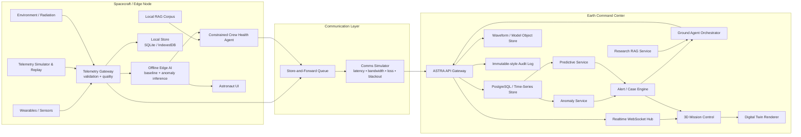
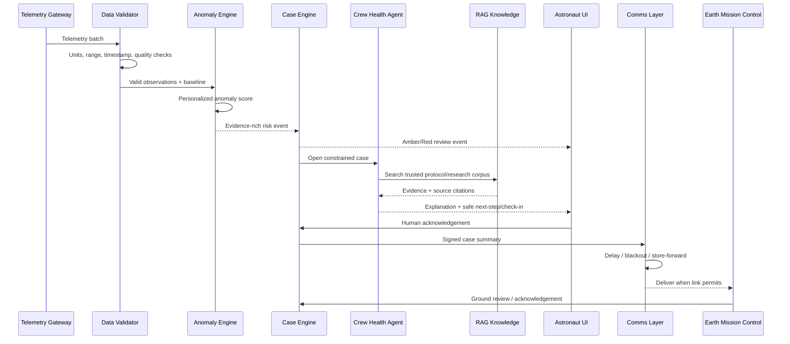

# ASTRA — Production-Ready, Modular, Research-Grade Specification for NASA Space Apps 2026

## Executive summary

**ASTRA should be built as a production-shaped research prototype of an Earth-independent crew-health intelligence platform, not as a conventional health dashboard and not as an autonomous “AI doctor.”** The official 2026 NASA Space Apps challenge asks teams to create software that gathers astronaut health indicators and helps astronauts evaluate and act on their health during long-duration missions, explicitly citing radiation, isolation and confinement, altered gravity, immune changes, bone loss, cardiovascular events, and behavioral-health problems. citeturn17search1 Your uploaded challenge guide independently identifies this challenge as a particularly strong fit for personalized baselines, offline operation, communication-delay simulation, anomaly detection, and a Crew Health Agent. fileciteturn0file0

The strongest technical framing is therefore:

> **ASTRA is a multimodal, offline-capable Crew Health Intelligence and Mission-Control platform that creates a continuously updated visual health twin of each crew member, detects deviations from personal baselines, explains the evidence, retrieves trusted space-health knowledge, and synchronizes crew-health cases with Earth despite communication delay or blackout.**

That framing closely matches the direction of NASA's own exploration-medical research. NASA's Exploration Medical Capability work describes a future clinical decision-support architecture that combines multiple health, environmental, behavioral, wearable, laboratory, and vehicle data streams because deep-space communication delays require progressively more Earth-independent medical operations. NASA's exploration EHR work likewise identifies asynchronous store-and-forward communication, onboard access to crew-health data, and increasing autonomy as important capabilities beyond low Earth orbit. citeturn16search3turn16search5turn15search12

The **winning version of ASTRA is not the version with the largest number of disconnected AI features**. It is the version that demonstrates one extraordinary end-to-end scenario in which every subsystem works together:

**sensor/simulator → validated telemetry → real-time Mission Control → 3D astronaut health twin → personalized anomaly detection → evidence/explainability → cited RAG knowledge → constrained Crew Health Agent → communication-delay queue → Earth review → complete audit trail.**

NASA research into Earth-independent operations now explicitly discusses integrated data systems combining multiple streams with AI-supported/agentic clinical decision support, which gives ASTRA's system-of-systems concept a strong scientific rationale. citeturn16search12

For the hackathon, the recommended product hierarchy is:

| Priority | What ASTRA must deliver |
|---|---|
| **P0 — competition-critical** | 3D Mission Control, live/replayed six-person crew telemetry, astronaut-specific detail view, animated 3D digital twin, deterministic synthetic scenarios, personalized anomaly detection, evidence panel, offline-capable knowledge assistant, communication-delay/store-and-forward simulation, source provenance, security roles, polished judge demo |
| **P1 — high-value differentiation** | Short-horizon risk/trend forecasts with uncertainty, sleep/fatigue and cognitive check-in, radiation/environment layer, agent orchestration, report generation, mission replay, model cards |
| **P2 — only after P0/P1 are stable** | Advanced waveform analytics, richer multi-organ anatomical layers, voice interaction, multi-omics research explorer, additional models, hardware wearable gateway, sophisticated WebGPU effects |

This prioritization directly supports the official 2026 local judging criteria published on the Space Apps site: **Impact, Creativity, Validity, Relevance, and Presentation**. citeturn17search12

One branding issue should be handled immediately. As of October 2026, the official Space Apps team directory already contains teams using names such as **ASTRAHEALTH** and **ASTRA – Astronaut Self-health Tracking & Risk Assessment** for this challenge. citeturn17search14turn17search15 Keep ASTRA internally, but give the submission a distinctive subtitle, for example:

**ASTRA Command — Autonomous Space Telehealth & Resilience Architecture**

or

**ASTRA-MED — Earth-Independent Crew Health Intelligence**

The technical specification below assumes **ASTRA Command** as the working product name.

## Scientific basis, scope, and assumptions

NASA's Human Research Program organizes the human-spaceflight problem around five hazards: **space radiation, isolation and confinement, distance from Earth, altered gravity fields, and hostile/closed environments**. HRP identifies associated risks including altered immune responses, cardiovascular adaptations, reduced cardiorespiratory and musculoskeletal fitness, spaceflight-associated neuro-ocular effects, bone changes, behavioral-health issues, and inadequate sleep or irregular schedules. citeturn14search13turn14search3turn14search6

ASTRA should therefore monitor multiple domains rather than reducing astronaut health to heart rate alone. At the same time, not everything NASA studies can be measured continuously. Recent human-spaceflight studies show changes in immune, metabolic, coagulation, oxidative-stress, bone, and molecular pathways, but much of that evidence comes from laboratory measurements at discrete pre-flight/post-flight time points rather than wearable real-time telemetry. The Inspiration4 multi-omic study, for example, reported immune and molecular changes from a four-member crew, while another Inspiration4 analysis observed changes in oxidative-stress, coagulation and other secretome-related signals; a long-duration astronaut study documented bone-metabolism changes. citeturn18search0turn18search1turn18search2

That distinction should shape ASTRA's scientific honesty.

| Health domain | ASTRA operational inputs | Research/context inputs | What ASTRA may claim |
|---|---|---|---|
| Cardiovascular | Heart rate, HRV-derived features, optional ECG/PPG waveform, BP if available | PhysioNet waveform datasets; HRP cardiovascular research | Deviation/trend from personalized baseline |
| Respiratory | Respiratory rate, SpO₂, PPG-derived signal quality | PhysioNet BIDMC | Monitoring/anomaly indication, not diagnosis |
| Sleep/circadian | Sleep duration, stage summary, schedule, subjective fatigue | Sleep-EDF; NASA behavioral-performance literature | Sleep/fatigue trend and check-in recommendation |
| Cognitive/behavioral | Reaction time, task performance, voluntary mood/fatigue survey | NASA behavioral research; recent EEG/cognitive spaceflight studies | Performance change relative to personal baseline |
| Exercise/musculoskeletal | Exercise session, workload, adherence, movement proxies | HRP musculoskeletal/bone research | Countermeasure/adherence trend; never “live bone density” |
| Environment | CO₂, temperature, humidity, radiation dose/rate | NASA OSDR Environmental Data App/RadLab | Environmental exposure/context |
| Radiation | Dose rate, cumulative mission exposure | NASA RadLab/space-radiation research | Exposure visualization and risk-context flagging |
| Immune/omics | Generally **not** continuous | OSDR Inspiration4, GeneLab/ALSDA | Research-context layer, not live physiology |
| Integrated risk | Personalized baseline + multiple validated inputs | Synthetic scenarios and public datasets | “Review required” or “elevated deviation,” not clinical diagnosis |

NASA OSDR is particularly valuable because it integrates physiological, behavioral, biomedical, bioimaging, omics and environmental data, while its Biological Data API provides REST and tabular query mechanisms. Most OSDR data are publicly accessible; NASA notes that processed astronaut-derived data may be publicly available while sensitive sequence data can be controlled access. citeturn14search2turn14search0turn14search11

Two useful human-spaceflight examples are **OSD-575**, containing Inspiration4 blood-serum metabolic and immune/cardiac cytokine arrays, and **OSD-656**, containing an Inspiration4 urine inflammatory-protein panel. Both are valuable for scientific context and simulator design, but neither should be represented as live astronaut telemetry. citeturn22search6turn22search4

NASA's Environmental Data Application includes environmental monitoring such as temperature, humidity, oxygen, carbon dioxide and radiation, while RadLab provides programmatic access to radiation telemetry. These are much more appropriate for ASTRA's environmental/radiation layer than trying to invent a “live NASA medical API.” citeturn22search5

Recent spaceflight research also supports including cognition while emphasizing uncertainty. A 2026 study demonstrated the feasibility of repeated EEG “brain vital signs” and neuropsychological testing in two astronauts around a 17-day ISS mission, but the authors explicitly cautioned about the tiny sample size. ASTRA should therefore offer short reaction-time/cognitive tests as **personal longitudinal measurements**, not population-level diagnostic scores. citeturn19search0

**Core assumptions for implementation**

| ID | Assumption |
|---|---|
| A-01 | Hackathon demo uses six fictional crew members and no identifiable real astronaut medical record. |
| A-02 | All generated telemetry carries `synthetic=true`; replayed public data carries its dataset provenance and license. |
| A-03 | “Live” means stream-as-received. A low-Earth-orbit demo may appear near-real-time; a Mars profile must visibly display delayed/stale Earth reception. |
| A-04 | ASTRA is a research/hackathon prototype, **not NASA-certified, flight-qualified, clinically validated, FDA-cleared or a substitute for a flight surgeon/crew medical officer**. |
| A-05 | Red status means **high-priority review/escalation in the simulated system**, not “this astronaut has disease X.” |
| A-06 | Detection logic works without an LLM. LLMs may explain, summarize and orchestrate restricted tools but never determine the sole safety-critical alert state. |
| A-07 | The 3D “digital twin” is a data-linked visualization/interaction twin, not a validated computational physiological model. |
| A-08 | Production-like engineering means modular APIs, testing, provenance, security and deployment discipline; it does not imply actual flight certification. |
| A-09 | Pre-event work must stay within the competition/local-event rules applicable to your team. The official 2026 site describes the project submission period as November 14–15 and encourages submission of what teams accomplish during the hackathon, so the team should verify its local rules before pre-building submission-specific code. citeturn17search0 |

**Prioritized source pack for the repository's `/docs/references` directory**

| Priority source | Implementation use |
|---|---|
| [NASA Space Apps 2026 astronaut-health challenge](https://www.spaceappschallenge.org/2026/challenges/create-health-monitoring-software-for-astronauts-on-space-missions/) | Authoritative challenge statement. citeturn17search1 |
| [NASA HRP — Five Hazards](https://www.nasa.gov/hrp/hazards/) | Scientific problem taxonomy. citeturn14search13 |
| [NASA-STD-3001 Volume 1 — Crew Health](https://www.nasa.gov/reference/nasa-std-3001v1/) | Requirements context for crew health, medical operations and records; **reference, not compliance claim**. citeturn15search0 |
| [NASA-STD-3001 Volume 2](https://www.nasa.gov/reference/nasa-std-3001v2/) | Human factors, interfaces and environmental-health context. citeturn15search10 |
| [NASA ExMC CDSS Architecture Recommendation](https://ntrs.nasa.gov/citations/20220017869) | Primary architectural inspiration. citeturn16search3 |
| [NASA EIMO Datascope](https://ntrs.nasa.gov/citations/20240000914) | Multimodal Earth-independent medical operations. citeturn16search5 |
| [NASA Exploration Electronic Health Record](https://ntrs.nasa.gov/citations/20230003216) | Store-and-forward/asynchronous crew health architecture. citeturn15search12 |
| [NASA OSDR](https://science.nasa.gov/biological-physical/data/osdr/) | Space-life-science research source. citeturn14search2 |
| [NASA OSDR Biological Data API](https://visualization.osdr.nasa.gov/biodata/api/) | Programmatic OSDR retrieval. citeturn14search0 |
| [OSD-575 Inspiration4 serum study](https://osdr.nasa.gov/bio/repo/data/studies/OSD-575) | Human-spaceflight research context. citeturn22search6 |
| [OSD-656 Inspiration4 inflammation study](https://osdr.nasa.gov/bio/repo/data/studies/OSD-656) | Human-spaceflight research context. citeturn22search4 |
| [PhysioNet BIDMC PPG/Respiration](https://physionet.org/content/bidmc/1.0.0/) | ECG/PPG/respiration waveform realism. citeturn22search1 |
| [PhysioNet Sleep-EDF Expanded](https://physionet.org/content/sleep-edfx/1.0.0/) | Sleep recordings and expert sleep-stage annotations. citeturn14search12 |
| [PhysioNet Pulse Transit Time PPG](https://physionet.org/content/pulse-transit-time-ppg/1.1.0/) | Multi-sensor wearable data from healthy volunteers performing physical activities. citeturn22search11 |
| [Inspiration4 single-cell multi-ome paper](https://www.nature.com/articles/s41467-024-49211-2) | Recent peer-reviewed spaceflight physiology. citeturn18search0 |
| [Inspiration4 secretome paper](https://www.nature.com/articles/s41467-024-48841-w) | Recent multi-system physiology evidence. citeturn18search1 |
| [2026 Brain Vital Signs spaceflight study](https://spj.science.org/doi/10.34133/space.0547) | Cognitive/neurophysiological research context. citeturn19search0 |
| [HL7 FHIR heart-rate Observation example](https://hl7.org/fhir/observation-example-heart-rate.html) | Health-data semantics. citeturn20search0 |
| [NIST AI RMF](https://www.nist.gov/publications/artificial-intelligence-risk-management-framework-ai-rmf-10) | AI governance/evaluation framework. citeturn21search2 |

## System architecture and data contracts

ASTRA should follow a **hybrid edge/ground architecture**. Safety-critical telemetry validation and anomaly scoring run onboard/local first. Earth Mission Control receives what the communication model permits. The LLM is deliberately outside the critical detection path. This reflects NASA's exploration-medical direction, in which onboard systems must integrate present/historical crew-health information and operate when terrestrial support is delayed or unavailable. citeturn16search1turn16search7



**Core persistence model**

| Table | Essential fields | Purpose |
|---|---|---|
| `missions` | `id`, `name`, `profile`, `mission_day`, `location`, `one_way_latency_ms`, `status` | Mission context |
| `crew_members` | `id`, `mission_id`, `call_sign`, `role`, `avatar_asset`, `baseline_version` | Fictional/de-identified crew |
| `telemetry_points` | `event_id`, `crew_id`, `ts`, `metric_code`, `value`, `unit`, `quality`, `source`, `synthetic`, `scenario_id` | Scalar observations |
| `waveform_chunks` | `id`, `crew_id`, `channel`, `start_ts`, `sample_rate`, `sample_count`, `uri`, `hash` | ECG/PPG/respiration segments |
| `health_baselines` | `crew_id`, `metric_code`, `center`, `scale`, `method`, `window`, `version` | Personalized baseline |
| `risk_events` | `id`, `crew_id`, `created_at`, `severity`, `detector`, `score`, `evidence_json`, `status` | Explainable anomalies |
| `predictions` | `id`, `crew_id`, `target`, `horizon`, `estimate`, `low`, `high`, `model_version` | Forecasts + uncertainty |
| `agent_cases` | `id`, `risk_event_id`, `state`, `summary`, `citations`, `human_ack` | Agent workflow |
| `knowledge_documents` | `id`, `title`, `publisher`, `url`, `version`, `sha256`, `accessed_at` | RAG provenance |
| `knowledge_chunks` | `id`, `document_id`, `section`, `text`, `embedding_ref` | Retrieval units |
| `comms_messages` | `id`, `origin`, `destination`, `created_at`, `deliver_at`, `priority`, `status`, `payload_hash` | Delay/blackout simulation |
| `scenario_runs` | `id`, `scenario`, `seed`, `started_at`, `configuration`, `labels` | Reproducible simulation |
| `audit_events` | `id`, `ts`, `actor`, `action`, `resource_type`, `resource_id`, `result`, `metadata` | Security/research traceability |

Use **FHIR-inspired semantics without forcing a complete hospital FHIR server into a hackathon**. FHIR's Observation resource is explicitly intended for measured observations, including vital signs; its heart-rate example uses LOINC `8867-4` and UCUM `/min`. ASTRA should therefore retain `metric_code`, coding system, unit, subject, observation time and data quality in its internal representation, while exposing an optional FHIR adapter later. citeturn20search0

**Canonical telemetry event**

```json
{
  "schema_version": "astra.telemetry.v1",
  "event_id": "01JASTRA4YK82E8N5M9X",
  "mission_id": "MARS-DEMO-01",
  "crew_id": "CREW-03",
  "ts": "2026-11-14T11:04:05.231Z",
  "received_ts": "2026-11-14T11:04:05.416Z",
  "metric": {
    "system": "http://loinc.org",
    "code": "8867-4",
    "name": "heart_rate",
    "value": 78.0,
    "unit": "/min"
  },
  "quality": {
    "status": "good",
    "confidence": 0.98,
    "artifact": false
  },
  "source": {
    "kind": "simulator",
    "device_id": "SIM-PPG-03",
    "sampling_hz": 1
  },
  "provenance": {
    "synthetic": true,
    "scenario_id": "sleep-debt-cardio-drift",
    "seed": 42017
  }
}
```

**Canonical anomaly/risk event**

```json
{
  "schema_version": "astra.risk-event.v1",
  "risk_event_id": "RISK-2026-000417",
  "crew_id": "CREW-03",
  "created_at": "2026-11-14T11:07:11Z",
  "severity": "warning",
  "status": "open",
  "detector": {
    "name": "personalized_robust_baseline",
    "version": "2.0.0",
    "score": 0.82
  },
  "evidence": [
    {
      "metric": "heart_rate",
      "direction": "above_personal_baseline",
      "standardized_deviation": 2.4,
      "persistence_seconds": 180
    },
    {
      "metric": "sleep_duration",
      "direction": "below_personal_baseline",
      "persistence_days": 4
    }
  ],
  "data_quality": "good",
  "uncertainty": {
    "confidence": 0.81
  },
  "display": {
    "body_region": "thorax",
    "status_text": "Persistent multi-signal deviation — review required"
  },
  "safety": {
    "diagnosis": null,
    "requires_human_acknowledgement": true
  },
  "provenance": {
    "synthetic": true,
    "scenario_id": "sleep-debt-cardio-drift"
  }
}
```

The status model should be **Green / Amber / Red / Gray**, with status always represented by icon/text in addition to color. NASA's current human-system guidance includes alert prioritization and redundant coding considerations, reinforcing the need not to rely on color alone. citeturn15search11

| Status | ASTRA meaning |
|---|---|
| Green | Readings are within expected personal pattern with sufficient data quality |
| Amber | Persistent deviation, deteriorating trend, or data-quality concern requiring review |
| Red | High-priority simulated deviation/case requiring immediate crew/ground review |
| Gray | Stale, absent, offline or unreliable data; **never interpret as healthy** |

**External and internal API contract**

| Method | Endpoint | Principal | Purpose |
|---|---|---|---|
| `GET` | `/v1/missions` | authenticated user | Mission list/context |
| `GET` | `/v1/missions/{id}/crew` | viewer+ | Crew overview |
| `GET` | `/v1/crew/{id}` | viewer+ | Individual crew profile |
| `GET` | `/v1/crew/{id}/telemetry` | viewer+ | Historical scalar data |
| `GET` | `/v1/crew/{id}/waveforms` | authorized clinical/research role | Decimated/replayed waveform chunks |
| `WS` | `/v1/stream/missions/{id}` | authenticated subscriber | Real-time aggregated feed |
| `POST` | `/v1/ingest/telemetry` | `telemetry:write` service | Single/batch scalar ingest |
| `POST` | `/v1/ingest/waveforms` | `telemetry:write` service | Binary waveform chunk ingest |
| `GET` | `/v1/alerts` | viewer+ | Current/past risk events |
| `POST` | `/v1/alerts/{id}/ack` | astronaut / flight-surgeon / mission-control | Human acknowledgement |
| `POST` | `/v1/scenarios/{id}/start` | demo-admin | Start deterministic simulation |
| `POST` | `/v1/scenarios/{id}/stop` | demo-admin | Stop scenario |
| `POST` | `/v1/rag/query` | astronaut/medical/mission-control | Grounded knowledge retrieval |
| `POST` | `/v1/agent/cases` | authorized user/service | Open an agent case |
| `GET` | `/v1/agent/cases/{id}` | authorized role | Agent state + evidence |
| `POST` | `/v1/comms/messages` | crew/mission-control | Store-and-forward message |
| `GET` | `/v1/comms/queue` | authorized role | Queued/in-transit/delivered messages |
| `POST` | `/v1/comms/control` | demo-admin | Set delay, loss or blackout |
| `GET` | `/v1/models` | researcher/admin | Model cards/version info |
| `GET` | `/v1/audit` | auditor/admin | Audit timeline |
| `GET` | `/v1/health` | public/internal monitor | Service readiness/liveness |

Use OAuth/OIDC-style identities and short-lived bearer credentials for production-shaped deployments. Do not place persistent access tokens in URL query strings. Demo mode may use seeded local identities but must preserve the same role checks.

**Primary alert interaction**



For Mars-mode demonstrations, ASTRA must distinguish **spacecraft observation time**, **transmission time**, and **Earth receipt time**. NASA publications discuss one-way Mars communication delays on the order of roughly 20 minutes, with geometry-dependent figures reaching about 22 minutes and periods of communication blackout, so “Earth live monitoring” cannot honestly mean zero-latency Mars telemetry. citeturn16search0turn16search8

## Module specifications and technology choices

The recommended stack optimizes for a small hackathon team that needs both a premium 3D web experience and Python-based scientific/AI development.

| Decision | Recommended | Alternative | Trade-off |
|---|---|---|---|
| Web shell | **Next.js + React + TypeScript** | Vite/React | Next gives one structured app and PWA path; Vite is simpler/lighter |
| 3D | **Three.js + React Three Fiber** | Babylon.js / Unity WebGL | R3F integrates naturally with React; Babylon is strong standalone 3D; Unity produces rich scenes but complicates web/UI integration |
| Animation | **GSAP + R3F animation loop** | Framer Motion only | GSAP better for cinematic timelines; Framer best for DOM transitions |
| Backend | **FastAPI + Python** | NestJS | FastAPI keeps ML/data services in one language; NestJS is strong if team is TypeScript-heavy |
| DB | **PostgreSQL** | InfluxDB | Postgres minimizes infrastructure; specialized time-series DB adds capabilities at operational cost |
| Local DB | **SQLite** | embedded document DB | Reliable, simple, offline |
| Streaming | **WebSockets** | SSE | WebSockets handle bidirectional mission state; SSE is simpler for one-way feeds |
| Cache/event bus | **Redis optional** | NATS/Kafka | Redis is enough for the expected prototype scale; Kafka is unjustified for the hackathon |
| Vector retrieval | **pgvector or FAISS** | separate vector DB | Fewer services; dedicated vector service only if genuinely needed |
| Model inference | **scikit-learn/ONNX/PyTorch where needed** | all-PyTorch | Avoid heavy runtime for simple models |
| Agent control | **explicit state machine/tool graph** | free-form autonomous agent | Deterministic state transitions are safer and easier to test |
| Offline LLM | **small quantized instruct model through a local runtime** | cloud LLM | Offline demonstrates mission relevance; cloud provides stronger language performance |
| Packaging | **Docker Compose** | Kubernetes | Compose is reproducible and judge-friendly; Kubernetes adds no hackathon value |

Next.js maintains official guidance for service-worker-backed PWAs, which makes it a credible shell for ASTRA's offline mode. Current Three.js `WebGLRenderer` requires WebGL2, so a startup capability check and non-3D fallback are mandatory on judge hardware. citeturn20search11turn21search0turn21search3

**Module implementation contract**

| Module | Purpose and functional requirements | Interfaces/data | Stack options | Performance budget and test gate |
|---|---|---|---|---|
| **3D Mission-Control Frontend** | Crew grid; Green/Amber/Red/Gray status; synchronized live charts; mission clock; spacecraft/Earth visualization; alert center; AI cases; comm status; timeline/replay; reduced-motion mode; responsive 1080p judge mode | REST crew/history; mission WebSocket; alert stream | **Next.js/R3F/GSAP**; Vite/R3F alternate | **Assumption target:** interactive shell ≤3 s after warm local start; 60 FPS target, ≥30 FPS performance mode; E2E screenshot and keyboard tests |
| **Digital-Twin Renderer** | 360° blue/translucent human; heart pulse; respiratory movement; anatomy/health-domain layers; body-region highlights; click-to-inspect; timeline transitions; no invented pathology | `risk_event.display.body_region`; telemetry stream; asset manifest | **R3F/Three.js GLB**; Babylon alternate | Target 30–60 FPS; progressive LOD; initial twin assets preferably ≤15–20 MB; body highlight must be reproducible from event evidence |
| **Telemetry Simulator / Ingest** | Six crew; deterministic seeds; normal physiological patterns; activity/sleep schedules; scenario perturbations; noise/missingness/artifacts; CSV/public-waveform replay; scalar and binary waveform streams | `/ingest/telemetry`, `/ingest/waveforms`; scenario APIs | **Python asyncio**; Node simulator alternate | Target ≥100 scalar observations/s locally; deterministic replay test must produce identical labels |
| **Backend API** | Authentication, crew/mission state, validation, persistence, history, alert/case workflow, report API, stream fanout, audit | All `/v1/*` endpoints | **FastAPI**; NestJS alternate | Local API p95 target <200 ms for simple reads; telemetry-to-UI p95 <500 ms under demo load |
| **Anomaly Detection** | Learn personal baselines; single/multivariate deviations; persistence logic; data-quality gating; confidence/evidence output | telemetry + baseline → `risk_event` | **robust z/MAD + EWMA + Isolation Forest**; autoencoder optional | Critical inference <50 ms/batch CPU target; frozen scenario regression suite; never invoke LLM for base alert |
| **Predictive Models** | Forecast trend and uncertainty; identify deteriorating trajectories; provide model evidence; abstain on insufficient history | aggregate features → `prediction` | **linear/quantile/gradient-boosted baseline**; temporal neural model optional | CPU inference <250 ms target; time/crew-disjoint validation; calibrated intervals required |
| **Agent Orchestration** | Gather telemetry/baseline/evidence; retrieve knowledge; ask check-in; draft case report; queue Earth message; stop/escalate when uncertain | `get_vitals`, `get_baseline`, `get_alert`, `search_knowledge`, `draft_report`, `send_message` | **Custom/LangGraph-style state graph**; unconstrained agent rejected | 100% tool authorization tests; critical path independent of LLM; no unrestricted shell/web/tool access |
| **Medical/Research RAG** | Search curated NASA/HRP/OSDR/NTRS/peer-reviewed corpus; quote minimally; cite exact source; version documents; abstain when unsupported | `/rag/query`; document/chunk metadata | **pgvector/FAISS + local embeddings**; external vector DB optional | Every substantive answer contains source citation or abstains; retrieval regression set |
| **Offline Edge AI** | Run baseline/anomaly logic and essential RAG without Internet; cache recent telemetry; queue outbound events; synchronize after reconnect | local SQLite/IndexedDB; sync API | **local Python daemon + browser PWA**; browser-only WASM/ONNX alternate | Network-off test must keep P0 monitoring operational; queue survives restart |
| **Communication Simulator** | Configurable one-way delay, jitter, bandwidth cap, loss, blackout, priority queue, message delivery timeline, time acceleration for judge demo | comm message/queue APIs | **Python scheduler/Redis optional** | No message arrives before `deliver_at`; blackout/reconnect tests; duplicate prevention |
| **Security / Roles** | Identity, RBAC, data minimization, encryption, audit, provenance, model access restrictions | OIDC/JWT, audit API | **external OIDC provider for cloud; local seeded auth for demo** | Negative authorization test for every privileged endpoint; all acknowledgements audited |
| **Testing & Validation** | Unit, contract, integration, E2E, load, chaos, AI regression, RAG eval, security, visual regression | CI fixtures/scenarios | **pytest + Playwright + frontend unit suite + load tool** | All P0 tests green before feature additions |
| **Deployment** | Local one-command demo, cloud profile, disconnected profile; versioned models/assets/data | Compose/env/config manifests | **Docker Compose**; native scripts backup | Fresh-machine bootstrap documented; judge demo must not depend on downloading packages during presentation |

The digital twin deserves one explicit design rule: **animation follows measurement, not imagination**. A heart-rate value may drive heartbeat animation; an actual ECG replay may synchronize to R-peaks; respiratory rate may drive a subtle respiratory cycle. An elevated anomaly may highlight the relevant domain. But a heart-rate deviation must not cause ASTRA to visually invent a blocked artery, arrhythmia, damaged organ or other diagnosis.

For performance, do **not** serialize every waveform sample as JSON. PhysioNet BIDMC contains ECG, PPG and respiratory signals sampled at 125 Hz, with HR/RR/SpO₂ numerics at 1 Hz. citeturn22search0turn22search1 For six simulated crew members, three 125-Hz float32 channels alone are about **0.78 GB/day before metadata/compression**. ASTRA should therefore write waveform data in short binary chunks, retain/stream decimated versions for visualization, and store scalar/derived features separately.

Recommended rendering hierarchy:

**Scene layer:** Earth, spacecraft, orbital/communication path, particles.

**Interface layer:** HTML/DOM cards and charts rather than rendering every piece of text in WebGL.

**Twin layer:** optimized GLB model, organ/health-region meshes, animated shaders, labels.

**Emergency layer:** alert halo, evidence lines, body-region focus camera.

**Fallback layer:** static/2D body map if WebGL2 or GPU performance is insufficient.

The visual objective is **NASA Mission Control credibility with premium cinematic transitions**, not an unreadable science-fiction HUD.

## Data, AI, testing, and validation

A research-grade project needs a strict boundary between **real public research data**, **replayed waveform data**, and **synthetic mission telemetry**.

PhysioNet's BIDMC dataset has 53 eight-minute recordings containing PPG, impedance respiration and ECG at 125 Hz plus HR, respiratory rate and SpO₂ numerics at 1 Hz, but those data came from critically ill hospital patients. They are useful for waveform structure, artifacts and pipeline testing, **not astronaut clinical calibration**. citeturn22search0turn22search1 Sleep-EDF contains 197 whole-night polysomnographic recordings with EEG/EOG/chin EMG, event markers and expert-scored hypnograms, and is useful for testing sleep-processing components without pretending that it represents an astronaut population. citeturn14search12

The healthier PhysioNet Pulse Transit Time PPG dataset contains synchronized PPG, ECG, inertial and other sensor channels from 22 healthy participants performing three physical activities, making it another useful source for signal/replay realism while still carrying an obvious Earth-population domain shift. citeturn22search11

**Dataset-use matrix**

| Source | Public? | ASTRA usage | Forbidden interpretation |
|---|---|---|---|
| NASA OSDR OSD-575 | Public study, CC0 metadata/source indicates CC0 | Scientific context for serum/metabolic/immune research | “Real-time astronaut biomarker feed” |
| NASA OSDR OSD-656 | Public study, CC0 | Research/knowledge graph, simulator context | Live inflammatory diagnosis |
| OSDR Environmental Data / RadLab | NASA public interfaces/API | Environmental/radiation context | Individual medical diagnosis |
| PhysioNet BIDMC | Open access subject to ODC Attribution license | ECG/PPG/respiration waveform pipeline and artifact testing | Astronaut-specific normal ranges |
| PhysioNet Sleep-EDF | Open-access database | Sleep-stage pipeline and testing | Astronaut sleep normative population |
| PhysioNet PTT-PPG | Open access | Activity/wearable signal simulation | Spaceflight physiology ground truth |
| ASTRA synthetic mission set | Project-generated | Core hackathon demo and labeled ML evaluation | Clinical evidence |
| NASA/HRP/NTRS papers | Public research/docs | RAG, design justification, feature taxonomy | NASA approval of ASTRA |

OSDR's Inspiration4 datasets and related 2024 peer-reviewed analyses are useful precisely because they expose how limited human-spaceflight sample sizes remain. The multi-ome study involved four Inspiration4 crew and explicitly notes limitations around sample size and generalization. citeturn18search0 ASTRA should therefore avoid claiming that a deep network trained on tiny spaceflight cohorts can diagnose future astronauts.

**Synthetic telemetry model**

Generate each channel as:

\[
x_{i,m}(t)=B_{i,m}+C_{i,m}(t)+A_{i,m}(t)+S_{i,m}(t)+\epsilon_{i,m}(t)
\]

where:

- \(B\) is the astronaut-specific baseline;
- \(C\) is circadian/longitudinal structure;
- \(A\) is activity/exercise/sleep-related variation;
- \(S\) is the deliberately injected scenario signal;
- \(\epsilon\) represents sensor noise/artifact/missingness.

The synthetic generator should not begin from fixed “healthy versus sick” labels. It should create a personal baseline first, then introduce explicitly controlled deviations.

Example configuration:

```yaml
scenario:
  id: sleep-debt-cardio-drift-v1
  seed: 42017
  crew_id: CREW-03

baseline:
  history_days: 30
  personalized: true

events:
  - type: sleep_reduction_pattern
    onset_day: 91
    duration_days: 4
    sleep_duration_delta_sd: -1.4

  - type: resting_hr_drift
    onset_day: 93
    duration_days: 2
    heart_rate_delta_sd: 2.2
    ramp: linear

sensor_quality:
  dropout_probability: 0.002
  spike_artifact_probability: 0.001

ground_truth:
  event_class: persistent_multisignal_deviation
  expected_severity: warning
  expected_detection_window_seconds: 300
  diagnosis: null

provenance:
  synthetic: true
  generator_version: "1.0.0"
```

Recommended demo scenario library:

| Scenario | Why it exists | Expected system behavior |
|---|---|---|
| Nominal mission day | False-alert baseline | Crew remains Green |
| Post-exercise recovery | Context-awareness test | Temporary deviation should not become Red |
| Progressive sleep/fatigue pattern | Longitudinal intelligence | Amber after persistence; cognitive check-in suggested |
| Multi-signal cardiorespiratory drift | Main judge scenario | Detect, explain, retrieve knowledge, escalate for review |
| Radiation/environment spike | Environment-health fusion | Environmental warning + exposure context |
| Sensor dropout/noise | Reliability test | Gray/data-quality alert, not medical alert |
| Contradictory sensors | Sensor-fusion test | Confidence falls; request measurement verification |
| Communication blackout | Earth-independence test | Local functions continue; messages queue |
| API/service restart | Resilience test | Stored data and scenario state recover |

**Anomaly-detection ladder**

Do not begin with an LSTM autoencoder merely because it sounds advanced.

**Tier A — mandatory:** robust personalized statistics such as median/MAD or rolling robust z-score, persistence rules, rate-of-change checks and data-quality gating. This is fast, interpretable and easy to validate.

**Tier B — mandatory if time permits:** Isolation Forest or similar multivariate unsupervised detector using normalized deviations, recent trends, activity context and quality indicators.

**Tier C — research extension:** temporal autoencoder/sequence model only if it materially outperforms simpler baselines on frozen scenario and public-signal tests.

The **combined health status should be a case engine, not one mysterious “AI health score.”** Judges should be able to open any alert and see precisely which observations, baseline deviations, persistence interval and model version caused it.

**Predictive service**

Forecasts should say things such as:

> “Resting heart-rate trend is projected to remain outside this crew member's recent baseline over the next six hours if the current trajectory continues.”

They should **not** say:

> “Astronaut will develop cardiovascular disease in six hours.”

Implement a simple baseline first: linear/robust trend or gradient-boosted regression with quantile/interval estimates. Train and evaluate chronologically; do not randomly mix future samples into training.

Required forecast fields:

```json
{
  "target": "resting_heart_rate_deviation",
  "horizon_minutes": 360,
  "estimate": 1.9,
  "lower": 1.1,
  "upper": 2.8,
  "units": "personal_baseline_sd",
  "confidence": "moderate",
  "model_version": "trend-v1",
  "clinical_diagnosis": null
}
```

**Agent architecture**

The agent should behave as a state machine:

`OBSERVE → VERIFY QUALITY → READ BASELINE → EXPLAIN EVENT → RETRIEVE EVIDENCE → REQUEST/RECOMMEND SAFE CHECK-IN → DRAFT CASE → HUMAN ACK → TRANSMIT`

Permitted tools:

```text
get_current_vitals(crew_id)
get_recent_trends(crew_id, window)
get_personal_baseline(crew_id)
get_data_quality(crew_id)
get_environment(mission_id)
get_open_risk_events(crew_id)
search_trusted_knowledge(query)
launch_cognitive_checkin(crew_id)
draft_case_summary(risk_event_id)
queue_ground_message(case_id)
```

Prohibited LLM capabilities should include unrestricted shell execution, arbitrary Internet browsing in medical mode, modifying telemetry, clearing alerts, editing personal baselines, issuing medication dosage, declaring a diagnosis, or bypassing human acknowledgement.

NASA's Earth-independent medical-operations work envisages AI-supported use of physiological wearables, behavioral data, environment, medical records and reference databases to support crew medical decision-making. citeturn16search5 NASA's peer-reviewed work on spaceflight CDSS similarly argues that greater Earth independence makes decision-support capability increasingly valuable. citeturn16search11 That is excellent justification for ASTRA's architecture, but not evidence that an unconstrained LLM is safe.

**RAG specification**

Corpus ingestion must be whitelist-based:

```text
NASA HRP pages
NASA-STD-3001
NASA NTRS ExMC/EIMO/CDSS/xEHR publications
NASA OSDR dataset metadata
Selected peer-reviewed spaceflight studies
Selected public physiology references approved by the team
```

Every document receives:

```json
{
  "document_id": "nasa-std-3001-v1-rev-c",
  "publisher": "NASA",
  "title": "NASA Spaceflight Human-System Standard Volume 1",
  "source_url": "...",
  "publication_date": "2023-09-15",
  "retrieved_date": "2026-10-17",
  "sha256": "...",
  "authority_tier": 1,
  "license_notes": "...",
  "corpus_version": "2026.11-demo"
}
```

RAG output must contain **source title + section/page when available + URL + retrieval confidence**. If support is insufficient, the answer should say the information is not established in the local knowledge base.

**Validation metrics**

| Component | Required metrics |
|---|---|
| Anomaly detection | Event-level recall, false alerts per simulated crew-day, detection latency, precision, scenario-specific confusion matrix |
| Prediction | MAE/median AE where applicable, interval coverage, calibration, forecast error by horizon |
| Data quality | Artifact detection recall, false sensor-failure rate, missingness behavior |
| RAG | Recall@k, citation correctness, answer supportedness, abstention correctness |
| Agent | Tool-selection correctness, unauthorized-tool rate, unsupported medical-claim rate, successful human-escalation rate |
| Realtime system | End-to-end latency, packet/message ordering, duplicate rate, disconnect recovery |
| UI | FPS, load time, interaction responsiveness, reduced-motion/accessibility behavior |
| Security | Authorization-denial rate, audit completeness, dependency/security scan |
| End-to-end | Percentage of defined scenarios completing the expected state transition |

Use **subject/crew-separated, scenario-separated and time-separated** evaluation. Do not let synthetic scenario labels leak directly into inference features.

A research-grade test suite should contain at least these layers:

| Test class | Examples |
|---|---|
| Unit | Baseline calculation, unit conversion, simulator seeded output, comm delivery-time calculation |
| Property | No message delivered before scheduled time; monotonic timestamps; invalid units rejected |
| Contract | Frontend/backend schema compatibility; OpenAPI generation |
| Integration | Ingest → DB → detector → alert → WebSocket → UI |
| AI regression | Frozen synthetic/public datasets produce expected metric bands |
| RAG regression | 30–50 curated questions with approved evidence |
| Agent safety | Prompt injection, dangerous instruction, unsupported medical query, unauthorized tool |
| E2E | Full Mission Day scenario with Playwright |
| Load | Six crew, target scalar rate, waveforms, multiple dashboards |
| Chaos | Network disconnect, API restart, Redis loss if used, stale telemetry |
| Visual | Key 3D/UI screenshots across judge resolution and performance mode |
| Offline | Wi-Fi disabled from start through alert and RAG response |

## Security, deployment, hardware, and operations

NASA-STD-3001's crew-health-record requirements state that crew health monitoring results need retrievable records for trend analysis, appropriate transmission mechanisms, and secure handling/storage/transmission because medical records contain sensitive personal information. citeturn15search4 ASTRA is not claiming compliance with that standard, but its architecture should clearly reflect those principles.

**Security model**

Use these application roles:

| Role | Read telemetry | Acknowledge alert | RAG | Scenario control | Modify model/config | Audit access |
|---|---:|---:|---:|---:|---:|---:|
| `viewer` | ✓ limited | — | — | — | — | — |
| `astronaut` | ✓ self/mission policy | ✓ self | ✓ | — | — | self |
| `mission_control` | ✓ | ✓ | ✓ | — | — | limited |
| `flight_surgeon` | ✓ | ✓ | ✓ | — | clinical-review config only | ✓ |
| `researcher` | de-identified | — | ✓ | — | model research | research |
| `demo_admin` | ✓ synthetic | ✓ | ✓ | ✓ | demo only | ✓ |
| `system_admin` | system-level | — | — | — | deployment config | ✓ |

For the Space Apps build, crew must be fictional. No team member should upload private real-world medical records simply to make the project seem more realistic.

Security requirements:

- TLS for networked deployment and encryption of persistent secrets.
- Strong secret separation between demo/client and ingest services.
- Role checks server-side rather than UI-only.
- Audit every login, alert acknowledgement, model/config version change and communication action.
- Hash/version RAG documents and models.
- Rate-limit ingest and RAG/agent endpoints.
- Reject stale/replayed telemetry IDs.
- Treat retrieved documents as **untrusted content**, not executable agent instructions.
- No LLM-generated SQL or shell commands in the production-shaped profile.
- No API keys in frontend bundles.
- Disable or strictly control telemetry export.
- Automated dependency/SBOM/security checks in CI.

NIST's AI Risk Management Framework is explicitly designed to help teams govern, measure and manage AI risk across the lifecycle, while NIST SP 800-218A extends secure-software-development practices to AI systems and models. These provide appropriate non-medical-device governance references for ASTRA's AI lifecycle. citeturn21search2turn20search15

The ethical boundary around medical advice must also be explicit. FDA's current CDS policy distinguishes informational decision support from software that produces specific diagnostic/treatment directives or supports time-critical clinical decisions, and patient/caregiver-facing functions raise additional regulatory considerations. citeturn20search2turn20search18 For a hackathon prototype, ASTRA should therefore use language such as **“review required,” “verify measurement,” “perform scheduled assessment,” “consult onboard protocol/medical officer,”** rather than autonomous diagnosis or medication instructions.

ASTRA's README and footer should display:

> **Research and simulation prototype. Not a medical device. Not NASA-certified or flight-qualified. Synthetic telemetry is clearly identified. AI output supports review and does not replace qualified medical judgment.**

**CI/CD pipeline**

```mermaid
flowchart LR
    PR["Pull Request"] --> LINT["Lint + Format + Typecheck"]
    LINT --> UNIT["Frontend + Backend Unit Tests"]
    UNIT --> CONTRACT["Schema / OpenAPI Contract Tests"]
    CONTRACT --> AI["Frozen AI + RAG Regression"]
    AI --> SEC["Dependency + Secret + Security Scan"]
    SEC --> BUILD["Build Frontend + Containers"]
    BUILD --> E2E["Playwright End-to-End"]
    E2E --> PERF["Performance Smoke Test"]
    PERF --> ART["Signed/Hashed Demo Artifacts"]
    ART --> LOCAL["Offline Compose Bundle"]
    ART --> CLOUD["Cloud Demo"]
```



Recommended repository:

```text
astra/
├── apps/
│   ├── mission-control-web/
│   └── crew-pwa/
├── services/
│   ├── api/
│   ├── telemetry-simulator/
│   ├── anomaly/
│   ├── prediction/
│   ├── rag/
│   ├── agent/
│   └── comms/
├── packages/
│   ├── schemas/
│   ├── ui/
│   ├── three-assets/
│   └── shared-types/
├── data/
│   ├── synthetic/
│   ├── fixtures/
│   └── public-metadata/
├── models/
│   └── model-cards/
├── knowledge/
│   ├── manifests/
│   └── indexes/
├── scenarios/
├── tests/
│   ├── integration/
│   ├── e2e/
│   ├── ai-eval/
│   └── safety/
├── infra/
│   ├── compose/
│   └── cloud/
└── docs/
    ├── architecture/
    ├── science/
    ├── references/
    └── demo/
```

**Deployment profiles**

| Profile | Components | Usage |
|---|---|---|
| `demo-local` | Web + FastAPI + Postgres/SQLite + simulator + AI + bundled RAG | Primary judge demo |
| `demo-offline` | PWA/local web + local API + SQLite + anomaly model + local RAG + optional local LLM | Network-disconnection wow moment |
| `cloud` | CDN/static web + container API/services + managed Postgres/object storage | Remote judges/video backup |
| `dev-lite` | Web + API + SQLite + simulator; no local LLM | Low-resource contributors |
| `research` | Full databases + notebooks/training pipeline + datasets | Model/data work |
| `judge-performance` | Reduced 3D particles/shadows/postprocessing; AI served by main demo laptop | Weak judge machine |

Do not make the judge's random laptop perform local model inference. Run ASTRA services from the team's controlled demo machine and let the judge client be a browser. The team's own laptop should also be capable of running the full offline profile for the network-disconnection demonstration.

**Engineering hardware assumptions — benchmark before competition**

| Environment | Minimum target | Preferred |
|---|---|---|
| Developer | 4+ modern CPU cores, 16 GB RAM, WebGL2-capable GPU, ~20 GB free disk | 8+ CPU cores, 32 GB RAM, discrete GPU or strong unified-memory GPU, ~40 GB free |
| AI/3D lead | 16 GB workable without heavy local model | 32 GB+ strongly preferred |
| Judge browser | Recent Chrome/Edge/Firefox-class browser, 8 GB RAM, WebGL2 | 16 GB RAM, discrete/modern integrated GPU |
| Demo host | 16 GB RAM without large local LLM | 32 GB RAM for frontend + DB + services + quantized local model |
| Network | Not required for core offline scenario | Available for cloud backup |

Current Three.js WebGL rendering depends on WebGL2, so startup should perform `isWebGL2Available()` and automatically select a 2D/reduced path when needed. citeturn21search0turn21search9

**Initial performance budgets — requirements, not measured results**

| Budget | Target |
|---|---:|
| Crew count | 6 |
| Scalar ingest | ≥100 observations/s local |
| Standard demo workload | 6 crew × ~10 scalar metrics × 1 Hz = 60 events/s |
| Waveform transport | 1–5 s binary chunks, never one JSON object per sample |
| Dashboard stream | Aggregate/decimate to useful visual rate |
| Telemetry-to-UI local p95 | <500 ms |
| Simple API local p95 | <200 ms |
| Anomaly inference | <50 ms/crew batch |
| Forecast request | <250 ms CPU for simple production model |
| 3D desktop target | 60 FPS |
| 3D minimum judge mode | ≥30 FPS |
| Initial critical 3D assets | Preferably ≤20 MB |
| Offline critical data | Recent telemetry + model + local knowledge corpus |
| RAG/LLM | Never block base anomaly/alert path |

The main operational invariant is:

> **If the LLM crashes, ASTRA still monitors health. If the Internet disappears, ASTRA still monitors health. If the 3D renderer fails, ASTRA still displays health.**

That one sentence should govern the architecture.

## Hackathon execution, acceptance criteria, and judge demo

The official 2026 NASA Space Apps Challenge takes place **November 14–15, 2026**; project submission opens November 14 at 09:00 and closes November 15 at 23:59 local time, and teams should contain no more than six participants. citeturn17search0 With the current date of October 17, there are roughly four weeks for permitted research, planning, source curation, team training and rehearsals before the event.

**Pre-event roadmap**

| Week | Deliverables |
|---|---|
| **Oct 19–25 — science and architecture freeze** | Final product story; architecture ADRs; schemas; API spec; NASA/OSDR/NTRS source manifest; dataset-license review; synthetic-scenario specification; Figma/storyboards; 3D asset research; benchmark candidate local models. Do only pre-event implementation that your event rules permit. |
| **Oct 26–Nov 1 — integration rehearsal** | Developer environment reproducibility; mock schemas; telemetry-generation research; GLB optimization workflow; anomaly-model experiments; RAG corpus/evaluation questions; comm-delay mathematics; security role matrix. |
| **Nov 2–8 — 48-hour dry run** | Rehearse a start-to-finish build against a throwaway/non-submission implementation if needed for rules compliance; measure which features consume the most time; finalize P0/P1 cuts; practice demo failover. |
| **Nov 9–13 — freeze and cache** | Final reference pack, dependency list, downloaded public datasets/docs, graphics/assets with licenses, pitch outline, judge-machine test checklist, team responsibility matrix, emergency backups. Avoid last-minute architectural changes. |

Because the official event messaging emphasizes building and submitting during the hackathon, confirm your local event's exact rule on prior code and pre-existing assets before producing the competition implementation. citeturn17search0turn17search9

**Six-person team allocation**

| Role | Primary ownership | Secondary ownership |
|---|---|---|
| **System Lead / Backend** | architecture, API, DB, integration, merges | deployment/security |
| **3D Frontend Engineer** | Mission Control, R3F, animations, performance | 3D twin |
| **Realtime/Data Engineer** | simulator, ingest, WebSocket, comms | persistence |
| **ML Engineer** | anomaly, prediction, synthetic evaluation | model cards |
| **AI/RAG Engineer** | RAG, agent graph, offline model | report generation |
| **Science/UX/QA/Pitch Lead** | NASA evidence, scientific validity, scenario labels, tests, storytelling/video | UI polish/documentation |

NASA Space Apps officially caps teams at six, making this ownership model directly compatible with the event. citeturn17search0

Every role should have a backup owner. No module should be understood by only one person.

**During-hackathon execution model**

| Time | Gate |
|---|---|
| Hour 0–3 | Repo, schemas, Docker/dev boot, mission/crew seed data |
| Hour 3–8 | Simulator → API → DB → WebSocket → basic charts working |
| Hour 8–14 | Mission Control UI + astronaut selection + digital twin |
| Hour 14–20 | Personalized baseline + anomaly engine + evidence events |
| Hour 20–24 | End-to-end P0 scenario works **before sleep/polish** |
| Hour 24–29 | RAG + constrained agent |
| Hour 29–33 | Communication delay + store-forward + offline mode |
| Hour 33–37 | Prediction/environment/cognitive P1 features |
| Hour 37–41 | Testing, security, performance, fallback mode |
| Hour 41–44 | Cinematic transitions and visual polish |
| Hour 44–46 | README, citations, model/data cards, architecture diagram |
| Hour 46–47 | Final demo recording and backup |
| Hour 47–48 | Submission buffer; no risky feature additions |

The **Hour-24 rule** is critical: by halfway through, one complete scenario must already work without advanced visual polish. An incomplete project with thirty feature branches is weaker than an integrated system that demonstrates one credible crew-health workflow.

**Definition of Done / acceptance criteria**

| ID | Acceptance criterion |
|---|---|
| AC-01 | Six fictional astronauts appear on Mission Control with continuously updating metrics and explicit data provenance. |
| AC-02 | Selecting an astronaut opens their dedicated 3D twin and synchronized historical/live graphs. |
| AC-03 | Heart animation follows the displayed HR/replayed beat timing rather than arbitrary animation. |
| AC-04 | Every body-region highlight is traceable to explicit telemetry/risk evidence. |
| AC-05 | A deterministic normal scenario runs for the agreed test interval without generating an expected high-priority medical event. |
| AC-06 | Main injected deviation is detected within its predefined simulation detection window. |
| AC-07 | Alert panel shows detector, model version, contributing signals, personal-baseline deviation, persistence, quality and uncertainty. |
| AC-08 | Sensor dropout produces Gray/data-quality state rather than false Red medical state. |
| AC-09 | Post-exercise/context scenario does not trigger the same response as unexplained persistent resting deviation. |
| AC-10 | Agent cannot create the original alert; it receives an already generated evidence-rich case. |
| AC-11 | Agent answers research/protocol questions only with curated sources or abstains. |
| AC-12 | Every RAG answer in the frozen judge question set contains a valid source reference. |
| AC-13 | Unsafe/unsupported medical queries are rejected or redirected to human review. |
| AC-14 | Wi-Fi/network can be disabled while telemetry, anomaly detection, core UI and local knowledge access continue. |
| AC-15 | Outbound message created during blackout remains queued and is delivered after communication restoration. |
| AC-16 | Mars-mode UI visibly distinguishes spacecraft event time from Earth-received time. |
| AC-17 | Viewer role cannot start scenarios, ingest telemetry, modify models or read protected audit resources. |
| AC-18 | Alert acknowledgement produces a traceable audit event. |
| AC-19 | All synthetic values are visibly identified in demo/data-source views. |
| AC-20 | 3D judge-performance mode sustains ≥30 FPS on the team's designated minimum machine. |
| AC-21 | The entire primary judge scenario has a Playwright/integration test or deterministic replay test. |
| AC-22 | Fresh local deployment starts from documented commands with no hidden manual configuration. |
| AC-23 | README documents limitations, public datasets, licenses, scientific references and “not a medical device/NASA-certified” statement. |
| AC-24 | Cloud failure cannot destroy the local judge demo. |
| AC-25 | The final submission video shows the working system rather than a collection of mockups. |

**Judge-criteria traceability**

| Space Apps criterion | ASTRA evidence |
|---|---|
| **Impact** | Supports crew-health awareness when Earth support is delayed; combines individual health, environmental context and communication resilience |
| **Creativity** | Interactive 3D health twin + dual spacecraft/Earth interfaces + communication-aware AI |
| **Validity** | NASA HRP/ExMC architecture, OSDR data, peer-reviewed research, transparent synthetic scenarios, explicit uncertainty |
| **Relevance** | Directly fulfills gathering health indicators and enabling astronauts to evaluate/act on health state |
| **Presentation** | One visually dramatic, scientifically honest Mission Day story instead of a feature-list presentation |

These are the five criteria identified on the official 2026 Space Apps local-event judging page. citeturn17search12

**Primary judge demo — approximately four minutes**

**Opening, 0:00–0:25 — Establish the mission**

Start on a cinematic 3D Earth/spacecraft scene.

Narration:

> “ASTRA Command is an Earth-independent crew-health intelligence system for long-duration exploration. It continuously builds a personalized health picture onboard and shares it with Earth whenever communication permits.”

Immediately state:

> “All crew telemetry in this demo is synthetic; NASA and public physiology datasets provide the scientific and signal-design foundation.”

This immediately earns validity points rather than forcing judges to ask whether the telemetry is fake.

**Mission Control, 0:25–0:55 — Show the mandatory Earth dashboard**

Transition from Earth to the command center.

Display all six crew members in one horizontal/mission grid:

```text
CREW-01   GREEN
CREW-02   GREEN
CREW-03   GREEN
CREW-04   GREEN
CREW-05   GREEN
CREW-06   GREEN
```

Graphs move in real time. Show link status, spacecraft event time, Earth receipt time, environment and mission day.

Say:

> “Mission Control sees the health data that has actually reached Earth; ASTRA never pretends delayed Mars telemetry is instantaneous.”

NASA's Earth-independent operations work gives a strong factual basis for that design. citeturn16search0turn15search12

**Digital twin, 0:55–1:25 — Deliver the visual wow factor**

Click CREW-03.

Camera transitions into the blue translucent 3D human.

Heart pulses with telemetry. Respiratory motion follows respiratory-rate input. A side panel shows personal baseline, current value, trend and quality.

Rotate the model.

Say:

> “This is not a decorative avatar. Every animation and highlighted region is tied to a specific observation or model event.”

This differentiates ASTRA from the many likely competitors building conventional health dashboards. The official Space Apps directory already shows multiple teams targeting AI-based astronaut monitoring, so pure “AI + dashboard” is unlikely to be sufficiently distinctive by itself. citeturn17search13turn17search14turn17search15

**Scenario injection, 1:25–1:55 — Make the system think**

From the hidden/demo Scenario Lab, trigger the frozen `sleep-debt-cardio-drift` scenario.

CREW-03 gradually transitions:

`GREEN → AMBER`

An evidence card appears:

```text
Persistent multi-signal deviation
HR: +2.4 personal-baseline SD
Sleep duration: below personal baseline for 4 days
Data quality: GOOD
Model: personalized_robust_baseline v2
Confidence: 0.81
```

The 3D model highlights the relevant physiological domain, but does **not** render an invented disease.

Say:

> “ASTRA does not ask a language model whether an astronaut is sick. The alert is generated by a deterministic, explainable personalized-baseline engine.”

That is one of the strongest technical decisions in the project.

**Agent + RAG, 1:55–2:35 — Show useful AI rather than AI theatre**

The Crew Health Agent automatically opens a case **after** the detector creates the alert.

Its visible steps:

```text
✓ Data quality checked
✓ Personal baseline retrieved
✓ Recent trends compared
✓ Relevant NASA research/protocol material retrieved
✓ Crew check-in recommended
✓ Ground report drafted
```

Open “Why?”

The answer should cite the local NASA/HRP corpus.

Show an uncertainty label.

Narration:

> “The agent is constrained. It can inspect health data, search our trusted onboard corpus, launch a check-in and draft a report. It cannot alter telemetry, erase alerts, diagnose independently or issue medication orders.”

That responsible architecture aligns with NASA's exploration CDSS research and contemporary AI risk-management principles. citeturn16search3turn21search2

**Disconnect Earth, 2:35–3:05 — The winning moment**

Click **COMM BLACKOUT** or physically disable network connectivity where practical.

Earth loses fresh packets. Spacecraft side continues:

```text
LOCAL MONITORING      ONLINE
EDGE ANOMALY ENGINE   ONLINE
LOCAL KNOWLEDGE       ONLINE
EARTH LINK             BLACKOUT
OUTBOUND REPORT        QUEUED
```

Narration:

> “This is why ASTRA exists. When Earth disappears, crew health monitoring does not.”

This is much stronger than merely saying “our app works offline.”

**Reconnect and synchronize, 3:05–3:30**

Restore communication.

Animate the queued report travelling from spacecraft to Earth. For a four-minute demo, accelerate simulation time while visibly showing the true configured mission delay.

Earth receives:

```text
CASE ASTRA-417
Original spacecraft timestamp: ...
Earth receipt timestamp: ...
Alert evidence: ...
Crew acknowledgement: ...
AI-generated summary: ...
NASA references: ...
```

Narration:

> “ASTRA preserves the difference between when an event happened and when Earth learned about it.”

That directly demonstrates asynchronous medical operations, which NASA's exploration EHR work identifies as necessary when communication becomes delayed or interrupted. citeturn15search12

**Scientific credibility, 3:30–3:50**

Open the **Evidence & Provenance** panel.

Show:

```text
NASA Human Research Program
NASA-STD-3001
NASA ExMC / EIMO
NASA OSDR
OSD-575 / OSD-656
PhysioNet
Peer-reviewed Inspiration4 studies
Model cards
Synthetic scenario manifest
```

Say:

> “We separate real NASA research, public physiology data and synthetic mission telemetry. We never present synthetic astronaut data as NASA operational data.”

NASA OSDR itself emphasizes both broad reuse of multimodal space-life-science data and controlled access where sensitive astronaut-derived information warrants it. citeturn14search2turn14search11

**Closing, 3:50–4:00**

Return to the 3D spacecraft/Earth view:

> **“ASTRA turns astronaut health monitoring from a dashboard into a resilient, explainable, Earth-independent health intelligence system.”**

The final product should therefore optimize for **three things simultaneously**: cinematic presentation, a genuinely working end-to-end technical system, and unusually strong scientific honesty. NASA's own research trajectory toward integrated crew-health data architectures and Earth-independent medical decision support makes that combination substantially more defensible than simply attaching a chatbot to a futuristic dashboard. citeturn16search3turn16search5turn16search16