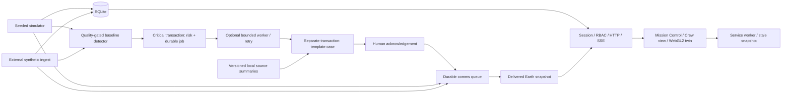

# Architecture and integration contracts

## N09-D01 fixed selected-crew scalar profile — 2026-10-24

`DEMO_HR` in shared contracts fixes one profile/version/timing/amplitude. The pure simulator envelope changes only target HR; the new preset uses nominal completed-sleep semantics. Existing canonical observations and N02 retain detector authority. `POST /v1/scenarios/controlled-hr-rise/start` accepts only `{seed,target_crew_id}` with a bounded integer seed and known fictional crew; seed may default to42017. Demo administrator and scenario permission are both required. Unknown fields/targets return422; protected/unknown/unreliable/non-resting target HR or unavailable baseline return409 without starting. Stop uses the existing active-scenario endpoint; it does not relinquish source ownership or restore blackout.

Engine checkpoints and existing `scenario_runs` JSON bind target/profile/version/parameters/start tick/mission times and phase/completion/stop/block metadata. Start and first tick share a transaction with in-memory/config rollback. Mid-run import blocks further offset application, while N01 retains imported observations. `scenario.demo` summarizes actual run-bound HR risks, case enrichment and uncertain coverage; no preset creates an alert/case or controls severity. Astronaut scope removes another crew's demo; frontend Earth reception mode withholds onboard demo details. The current UI is a shared local simulation, not independent ground authentication or a new N18 service. [N09_D01_COMPLETION](N09_D01_COMPLETION.md) documents tested contracts and remaining full N09 gates. No new database schema/service/dependency or detector/agent/scheduler redesign.

## N13-03 offline evidence-review packet — 2026-10-24

The additive [evidence-review compiler](../services/corpus/evidence-review.mjs) consumes the SHA-pinned frozen N13-01 corpus, N13-02 curation and explicit N13-03 review plan. It validates exact source/page/span/base-citation identities, unchanged case categories, bounded coverage/exclusions and pending independent decisions. The [offline CLI](../scripts/review-evidence.mjs) emits a deterministic packet, manifest and human review/coverage Markdown; verification reuses N13-02's saved targeted-page proof without new extraction. The manifest binds source/curation/plan/decision/export hashes. Four table-location records exclude numerical claims; the old Table 2 locator is corrected only in this additive layer. Existing originals/corpus/curation are immutable inputs.

This is preparation for real independent review, with no acquisition command, runtime service, database/API change or retrieval/model integration. All 40 independent decisions remain pending; passing hashes/schema/consistency checks cannot promote medical approval or close N07/N13. Actual approvals require external evidence and separately approved recording, not edits to generated fields. [N13_03_COMPLETION](N13_03_COMPLETION.md) records the remaining owner coverage, full N07 prerequisite and later-module gates. Existing monitoring/role/acknowledgement/communications/graphics contracts remain unchanged.

## N13-02 additive scientific curation —2026-10-24

[N13_02_COMPLETION](N13_02_COMPLETION.md) describes `services/corpus/curation.mjs` and the offline `scripts/curate-research.mjs` build/verify CLI. Load only the SHA-pinned frozen N13-01 corpus after verifying its two original receipts/hashes and existing source rights. Keep original documents/chunks untouched;versioned plans/overlay under `data/corpus/n13-02` bind source/page/UTF-16 ranges/text hashes/base citations,curated source-context boundaries,all5roles,correction ledger and ambiguity status. Mapping applies only to the intersecting reviewed span,not a global chunk rewrite or a semantic search. `resolveReviewedLocation` returns unknown for unreviewed/cross-boundary/ambiguous content;known section boundaries alone do not make text medically approved.

An offline bounded helper re-extracted only41selected original pages once;its saved hash/coverage proof is checked against unchanged original/frozen hashes during normal verify. No full471-page repetition,acquisition command,network,new dependency,service or database/API integration. Printed labels are original-text header checks,not rendered glyph validation.40reviewable expectations encode bounded supported claims,explicit unsupported clauses and abstention/refusal;engineering review remains separate from pending independent human approval. Formal shall statements,rationale/research findings/research agendas and caveats are distinct;table location cannot alone support quantitative claims. Future retrieval must use only approved coverage and retain uncertainty;no N14/N15/N16 is implemented or approved by this adapter. All monitoring/role/acknowledgement/communication/graphics behavior remains unchanged.

## N13-01 offline publication adapter —2026-10-24

[N13_01_COMPLETION](N13_01_COMPLETION.md) describes the standalone `services/corpus` libraries and `scripts/research-corpus.mjs` CLI. Reuse N07 secure regular-file/exclusive-write/abort/hash primitives without modifying its allowlist,limits,cache records or cards. A separate exact two-PDF policy and durable attempt markers enforce the approved resource identities,complete byte counts,time bounds,no redirects and no retries. Originals/receipts,source review and derived corpus live under `data/corpus/n13-01`;they are not a new database schema,service or implicitly served runtime API. Existing prototype knowledge/retrieval stays unchanged.

Only a local SHA-pinned pypdf6.21.2wheel is imported by an isolated bounded Unix/WSL subprocess. No network during rebuild/verify;no PDF actions/attachments/links executed or fetched. Output records preserve physical page_index,PDF label,exact text and hashes;printed labels and heuristic heading/content roles remain unverified. Chunk IDs bind original/page/range/text/chunker,not enumeration order. Citation fields bind source URL/document/original SHA/page/page SHA/section/chunk/range/text SHA. Offline verification rehashes originals and reproducibly re-extracts all pages before comparing stored pages,corpus and inventory;edited citations fail closed.10draft review questions carry exact anchors and explicit abstention boundaries,not runtime AI or medical approval. N13 In Progress;all full acceptance and DE-N07-N13-01/N07 obligations retained. No monitoring/forecast/graphics/role/communication changes.

## N07 approved Sleep-EDF source-specific exception —2026-10-24

Dedicated fixed two-file policy/streaming adapter reuses existing HTTPS/secure cache primitives,with50,000,000aggregate payload,300sPSG,15s-small and360s-network limits. Prior small-source cache/approval caps remain unchanged;only secure helper exports and three literal URLs are added. Incremental SHA,prefix checkpoints,exclusive ownership,retained failure state and atomic pair promotion gate complete EDF/EDF+ validation. An isolated scientific-bundle manifest describes multiple originals without migrating old records. Only full offline rehash/structure verification can issue an internal context for accepted card/split generation;persisted summaries/partials cannot. [N07_SLEEP_EDF_COMPLETION](N07_SLEEP_EDF_COMPLETION.md) records actual blocked transfer and fixture-only validation. No API,monitoring,graphics,AI or database integration;no automatic retry/resume.

## N07 fixed BIDMC numerics extension —2026-10-23

Only one exact public record-01 CSV adds a third acquisition source. Its dedicated validator pins URL/release/size/SHA,ODC-By+legacy notice,CSV dialect and real patient-derived nonclinical provenance. Cache selects only the validated original filename/MIME (`original.csv`/text-plain for BIDMC;prior JSON contracts unchanged);all byte/time/request/range/hash/locking/promotion safeguards remain. Offline card/split tooling preserves NaN and source-relative time/unknown identities;no live telemetry,monitor,forecast,AI,renderer or database integration. [N07_BIDMC_COMPLETION](N07_BIDMC_COMPLETION.md). This is one-sample acquisition,not a general CSV importer or independent training split.

## N07-02 fixed OSDR study adapter —2026-10-23

Acquisition now dispatches between two reviewed exact resources,defaulting to the preserved NTRS source. Existing validation primitives are shared via validation.mjs;osdr.mjs owns strict OSD-1/nonhuman parsing and source-bound dataset-card/split-policy contracts. The existing cache/transport implementation and limits are unchanged. OSDR uses a separate reviewed approval and immutable cache entry;no backend/API/domain/graphics integration is added.

The card distinguishes source facts from unavailable counts/version/grouping and references-only measurements. Split validation requires blocked/unexecuted status,null unknown allocations and no assignments;no model/data split occurs. scripts/osdr-study.mjs prepares/verifies local documentation without network or overwriting differing files. [N07_02_COMPLETION](N07_02_COMPLETION.md) records source-specific use conditions,actual acquisition,focused tests and remaining gates. N07 stays In Progress;N13+ implementation is not authorized.

## N07-01 acquisition boundary —2026-10-23

`services/acquisition/source.mjs` validates the reviewed exact NASA NTRS resource/publication/rights/size/hash policy;`cache.mjs` implements bounded HTTPS,verified partial recovery and content-addressed completed entries. `scripts/scientific-acquire.mjs` is an explicit offline-verify/acquire CLI. No API/monitoring/agent/retrieval/renderer imports it;no scheduler or runtime database is changed. One locally stored original JSON sample has publication metadata,actual use/attribution,source version,receipt and SHA256. Unknown sources/types,changed bytes and invalid metadata fail closed. Embedded text/URLs are inert and never become tools or instructions.

The existing native application remains unchanged. This is N07 acquisition infrastructure,not N13 corpus ingestion,N14 retrieval,N15 inference or N16 agent execution. [N07_01_COMPLETION](N07_01_COMPLETION.md) specifies byte/time/request bounds,range/validator/partial/lock/disposal limits,actual HTTPS/offline evidence and remaining dependencies. N07 remains In Progress,N05/N06 Deferred,N03 Partial,AC-20 Open / Unverified;STOP after this bounded task.

## Completed sleep lifecycle — bounded repair2026-10-23

The approved Last Sleep repair adds `astra.sleep-session.v1` records and append-only SQLite schema3 without replacing the API,store or telemetry architecture. `sleep.mjs` generates deterministic daily completions;Engine carries persistent per-crew state,holds canonical observations,appends corrections and commits ledger/telemetry/history/audit/comms/checkpoint atomically. Optional `sleep_session` metadata extends telemetry v1 under existing strict ordering/ownership/quality validation. The knowledge-time read route uses existing telemetry-read/self permissions;Earth views still use delivered immutable packets. Legacy scalar history remains unverified as a completed session. Unsupported sleep forecasts abstain;N02 detector rules remain unchanged. Exact integration contracts:[SLEEP_SESSION_CONTRACT](SLEEP_SESSION_CONTRACT.md);actual verification:[SLEEP_LIFECYCLE_COMPLETION](SLEEP_LIFECYCLE_COMPLETION.md). No graphics change or N05/N06 scope expansion. N04 Complete,N05 In Progress,N03 Partial,AC-20 Open / Unverified;STOP.

## N05-01 reference-anatomy boundary

The separately approved vertical slice adds AnatomyScene alongside the existing Scene, retaining constructor(container,type,options),update,size,camera,requestPaint and dispose lifecycle conventions. The app keeps exactly one active crew scene; profile/navigation changes dispose it. Reference anatomy is a selectable presentation beside the retained data-linked schematic, never a personalized physiological model. Its update method retains incoming projection data without using it to animate/highlight organs. Existing DOM metrics/history/evidence/roles/reception continue through graphics failure.

anatomy.mjs validates the local manifest and per-file length/SHA256, dynamically imports the local Three.js runtime only in Crew Health, loads body→organs→skeleton and checks cancellation after every async boundary. Static GLBs have no external buffers/textures/animations/extensions. Five astra_semantic_id values, not renderer UUIDs, define body/skeleton/heart/left-lung/right-lung identity. Rendering is demand-driven: load, resize, camera/layer change and visibility recovery; no continuous physiology/ambient loop. One frame owner, bounded pixel density, offscreen/hidden suspension, idempotent resource/listener/observer disposal and detached-late-parse cleanup isolate graphics failure. A15s bounded load timeout aborts to text, with the existing schematic/Canvas path available explicitly.

Only server extension: model/gltf-binary for .glb in the existing static allowlist. CSP/auth/stream/database/monitoring are unchanged. The service worker versions the small shell; heavier local geometry/runtime is cached on demand, not forced into startup. This is not full N17 offline certification. The pinned package is a build source; committed local vendor modules and assets run without npm install or Internet. ADR-019 and N05_01_COMPLETION record provenance, budget and remaining full-N05 gates. Earlier dependency-free/no-anatomy architecture statements below describe historical modules.

## Current N04 extension — native architecture retained

N04 is explicitly authorized under DE-AC20-01. `mission.css` layers material/type/layout tokens after the existing stylesheet; `app.mjs` retains authentication,request/session ownership,incremental DOM patching and `packages/presentation.mjs` projections. `ui.mjs` adds six authored insignias and optional observed-time trend positions. No framework,CDN,runtime npm dependency or backend redesign was introduced. The only backend change is `image/jpeg` in the existing bounded static MIME allowlist.

`earth.mjs` supplies a spherical texture-sampling WebGL2 material. `Scene` in `scenes.mjs` owns texture placeholders/loading/version guards,mipmaps,one frame loop,resize/intersection observers,keyboard/pointer controls and disposal. Local NASA surface/cloud variants are chosen by quality/container size;the shader is a visual approximation rather than a physical atmospheric/orbital model. Earth-camera controls never change telemetry. The twin's existing schematic shader algorithm is retained;no anatomical asset or picking expansion.

Quality-reduced graphics lowers texture resolution,render scale,pixel cap,cloud work and CSS blur/shadows while retaining animation. Reduced motion is a separate preference,including the authoritative OS setting;hidden/offscreen stages stop requesting frames. Failure to load imagery is labeled and cannot stop DOM monitoring;WebGL→2D→text fallbacks remain. `astra-shell-v3-n04` caches the new modules;full offline lifecycle remains N17. Source,asset,real-browser and remaining acceptance evidence: [N04_COMPLETION.md](N04_COMPLETION.md). N03 Partial,AC-20 Open / Unverified,N05+ unapproved. Earlier status/blocker paragraphs below are historical.

Status after the approved N03 continuation,2026-10-18: N01 per-channel ownership/private check-in scope and N02 independent monitoring/enrichment remain preserved. N03 adds a shared frontend presentation boundary, guarded requests and existing scene failure fallbacks.100 tests pass; real browser acceptance is Blocked, so N03 remains Partial and stopped. No rebuild or framework replacement. N04+ are unapproved. Contracts: [N02_CONTRACTS.md](N02_CONTRACTS.md), [N03_COMPLETION.md](N03_COMPLETION.md).

## Local deployment
Node 24 serves the static ES-module application and `/v1` API from one loopback origin. Native `node:sqlite` persists scalar observations, state, baselines, risk events, cases, messages, check-ins and hash-chained audit records. Separate importable domain modules implement simulation, validation, detection, prediction, retrieval and communications. No CDN, runtime download or cloud credential is required. This is a local edge/ground simulator inside one process, not a physically distributed medical network.

N01 continuity: validated imports atomically retain per-metric source ownership, canonical event/receipt/provenance metadata, derived freshness, history and sequenced Earth packets. Simulator ticks update only their own channels; scenario changes do not release imports. Held values do not create fake fresh scalar events. Incomplete legacy metadata is archived and Gray/unverified. N02 commits risk and enrichment job inside this same critical transaction; worker retrieval/case construction runs afterward and cannot erase it. Separate optional case/job/audit commits are retryable. Agent step labels still are not an executed tool graph (F09/N16).

## Contracts
- Telemetry: `astra.telemetry.v1`; event ID, mission/crew ID, UTC observation/received time, metric system/code/name/value/UCUM unit, quality/status/confidence/artifact, source and immutable provenance. HR uses LOINC 8867-4, `/min`; non-LOINC project measures use the ASTRA coding namespace.
- N01 validates UTC observation/gateway time order/bounds, device/sample-rate and synthetic seed/scenario/generator metadata; external service calls must identify synthetic-import rather than internal simulator. Imported times strictly advance per channel; out-of-order/conflicting batches reject atomically. Canonical metric_observations retain source data plus server-owned receipt/integrity annotations. Public replay/license and binary waveforms remain absent. Exact producer/freshness/legacy contract: N01_COMPLETION.
- Risk: `astra.risk-event.v1`; deterministic detector/version, severity, per-signal center/scale/deviation/persistence/quality, uncertainty wording, body region, `diagnosis: null`, synthetic provenance. Detector accepts measurements and context, never a scenario label.
- Snapshots: spacecraft time, server receipt time, six crew summaries, scenario/run/seed, environment, alert counts and communications. Ground snapshots are separate delayed immutable copies, never aliased spacecraft state.
- Communication: observation, queued, transmitted, earliest-delivery and received timestamps; idempotency ID, origin/destination, priority, payload hash, retries. Scheduling uses **simulation UTC milliseconds**; time acceleration is explicit. Packets cannot arrive before earliest delivery. Blackout stops transmission and reception.
- Retrieval: curated summary ID, title, publisher, section, URL, accessed date, summary hash, confidence and abstention. Summaries are project-authored paraphrases of checked public pages, not full downloaded research papers or embedded clinical protocols.
- Forecast: estimate/interval, unit, horizon, history count, model version and calibration provenance. A 30-minute, 60-point, 30-second-cadence input can use the frozen nominal-synthetic band; other supported histories show an explicitly uncalibrated residual interval. Abstain for poor quality, insufficient points or active deviations outside nominal calibration. No disease forecast.
- API errors: `{error: {code, message}}`, no stack trace to the client. N01 returns 400 for malformed Origin and 422 for unsupported telemetry fields/types; rejected writes do not publish partial updates. JSON bodies bounded; prepared statements; same-origin writes; HttpOnly/SameSite session cookie. GET state and SSE require authentication. Local demo login is explicitly labeled.

## Storage and failure boundaries
Database schema is versioned in `services/api/store.mjs`. Runtime state and scenario clock checkpoint every tick. WAL and transactions protect ingest; queue and acknowledgement operations are idempotent. Audit is append-only with SHA-256 chaining for tamper evidence; this is not external tamper-proof storage. Retention bounds scalar telemetry and delivered telemetry packets; cases/audit are retained. API process failure pauses simulation, which resumes at its persisted simulation clock after restart. Browser disconnection freezes readings as Gray; it does not fabricate new readings. Core services require no external Internet; physical network-off browser verification remains pending.

N02 schema version2 adds an indexed durable enrichment job table without replacing existing records. Legacy missing-case jobs and interrupted/failed work recover after restart. Core telemetry and scheduler rollback remain atomic; optional case/job/audit rollback is independent. Cases become available asynchronously; acknowledgement is409 until the case exists, with no automatic acknowledgement/transmission. Default workers have2s timeout and bounded memory; retries back off1s to60s using host time. Health inspects DB readiness and host-clock monitoring progress/failure/recovery; optional degradation is200/degraded, core failure/stall503. See N02_CONTRACTS for full fields and thresholds.

Audit limits: upgrade/restart fault tests cover current additive metadata/job migration, not a complete production backup/restore drill. Pending/in-transit packets, predictions/cases/audit/jobs can grow unbounded, while some UI/history record searches remain capped (F12). Retry-exhausted reports cannot currently be resubmitted with the same fixed ID (F07); no Earth-to-spacecraft review acknowledgement exists. N03 stale/health/focus/fallback software paths are tested through template events and mocked graphics, not an actual browser. N01 private check-in scope remains unchanged. Full production identity/de-identification/encryption/TLS remain N21. Forecasting, detector, engine and agent implementations are unchanged by N03.

## N03 frontend integration contracts

`packages/presentation.mjs` projects one authenticated snapshot into the selected onboard/received view. It never substitutes onboard crew, alerts or cases when Earth data is absent. Host packet age>5s, health age>7s, lost connection or core unready status makes current measurements Unknown/Gray; per-channel observation quality/freshness still gates values. Optional enrichment degradation is separate from monitoring readiness. Recorded alerts retain their event-time evidence and are not a current-health claim.

The browser polls health every2s and missing cases at most once per risk per5s, up to six jobs per pass. Structured503 is consumed as health evidence.202 means pending/failed/unknown enrichment;409 acknowledgement conflicts invalidate stale case availability. No client inference bypasses server permission, case availability or human acknowledgement. Page/session/crew/view request ownership and aborts reject obsolete responses. Logout/401 clears caches and state; validated network-unavailable cache mode is Gray/read-only and excludes cases/private check-ins.

Existing WebGL scene setup/draw/context loss falls back to2D, then text if2D fails. Essential monitoring DOM remains independent. Disposal removes listeners, observers, frames and graphics resources; reduced-motion/hidden scenes limit redraws. Advanced GL restoration and anatomy remain N06/N05. Browser lifecycle/layout proof is still blocked.

The existing scenario-stop route now rejects unknown IDs404/inactive stops409; valid stop returns200 and resumes nominal using the current seed. It preserves N01 imported ownership and earlier records; it is not a simulation pause. This is N03's only backend change.

The2026-10-18 N03 continuation changes no backend/renderer. app.mjs gives replay/check-in distinct breadcrumbs and explicit pending/empty/error states, disables replay until observations exist, and loads source/catalogue/model/audit panels independently with current-request/role guards.100 tests pass; the actual browser gate remains Blocked. The code-specific VISUAL_REDESIGN_PROPOSAL changes no runtime architecture and authorizes no N04/N05/N06 work.

## Endpoint compatibility
All research endpoints are tracked in FEATURE_AUDIT and REQUIREMENTS. SSE at `/v1/stream/missions/MARS-DEMO-01` is the documented permitted one-way alternative to WebSocket. Ingest has a dedicated service permission; demo administrators are not automatically telemetry services. Binary waveform routes return 501 and full FHIR adapters are absent. `/v1/openapi.json` is a route catalogue, not complete generated request/response schemas or security definitions; advertised response codes are incomplete. No real HTTP socket/browser integration was possible in the audit sandbox.
