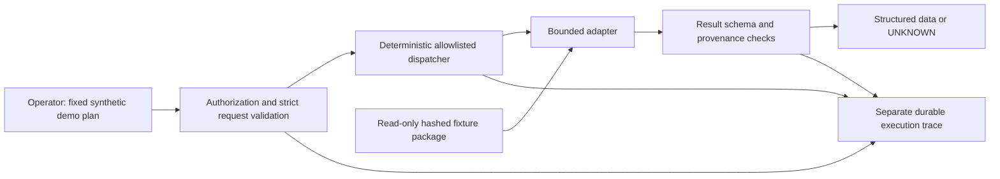

# N16 read-only executed-tool foundation — proposal, not implementation

## N16-02 owner-approved presentation extension — 2026-10-28

The owner separately approved a read-only Fixture Demo panel within Health Agent for the single preserved N16-01 demonstration, under the [activated task-specific extension](DE_N16_READONLY_01.md). This supersedes the original no-UI boundary only for archived trace presentation; operational workflow, full prerequisites and every live-data/model/action exclusion remain. Validate pinned artifacts and authorized crew scope without executing tools or constructing live services. N16 In Progress; N15 support rule remains inactive. STOP after N16-02.

Delivered: [N16_02_COMPLETION](N16_02_COMPLETION.md),40focused passes/six syntax checks, zero new tool/model executions, canonical read-only archive and unchanged operational handlers. This bounded authority is exhausted; no automatic integration or next task.

## Subsequent explicit approval and bounded delivery — 2026-10-28

Owner activated DE-N16-READONLY-01 and approved exactly N16-01. [Completion](N16_01_COMPLETION.md) records actual four-tool fixture reads/durable traces,48focused passes and cold recovery. N16 is now In Progress/not Complete; this task is exhausted. The original planning checkpoint below is historical, not a fresh requirement to reapprove the already delivered task or permission for any broader work. Full prerequisites, exclusions, N15 pending rule and independent-review gates remain.

2026-10-28. Owner approved **documentation only**. [DE-N16-READONLY-01](DE_N16_READONLY_01.md) is proposed/inactive. No dispatcher, adapter or tool is implemented/executed by this task. N16 Not Started; N15 In Progress; [N15-11](N15_11_COMPLETION.md) factual rule still unreviewed/inactive.

## Existing behavior and reusable interfaces

[agent.mjs](../services/agent/agent.mjs) exports ten tool-name strings and `authorizeTool`, which checks membership and acknowledgement for queueing. It does **not** dispatch handlers or validate crew arguments/role access for all those tools. `buildCase` calls existing lexical summary retrieval and generates deterministic text, with every apparent step prefilled `complete`. Its worker executes template construction, not an LLM tool graph. The [UI](../apps/mission-control-web/app.mjs) explicitly labels these as a workflow reference, with no executed graph/LLM. Preserve these truthful labels; old steps cannot be converted into successful execution records.

Research MiniLM/Qwen work is separate from the operational workspace. A saved offline generation, valid citation or proposed support rule is not an executed Health Agent or a scientific approval.

| Requested data | Existing reusable source/interface | Limit and proposed use |
|---|---|---|
| Synthetic vitals | `Engine.snapshot().crew`; authorized `GET /v1/crew/{id}` and `/v1/state`; canonical `metric_observations` | Prefer event values/units/IDs over bare display values. Snapshot records may contain imported channels despite synthetic edition labels; verify each source. Initial adapter reads only sealed simulator fixtures. |
| Quality | `metric_quality` and canonical observation quality; [retainObservation/refreshReading](../services/api/telemetry.mjs) | Integrity, source quality, artifact and stale flags remain distinct. `refreshReading` mutates its input: never call on operational state from a reader. Missing/contradictory metadata stays UNKNOWN. |
| Personal baselines | `reading.baseline`, `Engine.baselines`, stored `health_baselines`; [createBaselines](../services/telemetry-simulator/simulator.mjs) | Existing median/MAD baseline has center/scale/unit/method/count/version/synthetic. Its720 sampled calibration values and `window_days:30` are not a real dated30-day observation archive; full N09 remains open. No baseline editing/recalibration. |
| Recent trends | authorized `GET /v1/crew/{id}/telemetry`; `Store.history(crewId,limit,before)` | Existing bounded snapshot history, **not** a completed trend/forecast tool. Future adapter must deduplicate observation IDs and preserve source time/quality. Do not count held values as new samples. Omit from first slice. |
| Environment | `Engine.snapshot().environment`; authorized `/v1/state` | Simulator cabin CO₂/temp/humidity/O₂/dose context and illustrative environment warnings. Per-value quality/source/time metadata is weaker than canonical crew events; never invent equivalent provenance or NASA-certified limits. Omit from first slice. |
| Existing N02 alerts | `Store.record/list('risk_events')`; authorized `GET /v1/alerts`; risk evidence includes observation/source/baseline/persistence | Read existing records only; no evaluate/create/acknowledge. Snapshot list is capped100, so absence is not proof of mission-wide absence. Scope by crew/run/time/status and report coverage. |
| Freshness/provenance | canonical event `ts`, `received_ts`, source, seed/scenario/generator, ingestion annotations; snapshot scenario/run metadata | API response `server_received_at` is not observation time. Current scalar/Last Sleep source-time semantics remain. Missing run identity is unknown, not inferred from an arbitrary ID. |
| Ship versus Earth | snapshot `crew/environment/alerts` versus delivered `ground`; [queueSnapshot/processComms](../services/api/engine.mjs) preserve transmission/reception | View is explicit trusted context. Future Earth reads use only delivered ground data; never fall back to current ship state. Initial slice supports onboard fixtures only; Earth requests reject as unsupported. |

These are source-level findings, not calls made in this planning task. [Store](../services/api/store.mjs), [Engine](../services/api/engine.mjs) and `createApp` constructors create schemas/state, seed/detect, queue jobs or start services. **Do not instantiate them to obtain supposedly read-only access.** Existing SELECT methods are reusable semantics, not an isolated capability boundary. Future live access needs separate approval and a narrowed adapter; no generic store/engine object crosses into a dispatcher/model.

## Proposed architecture

Use the existing Node/module architecture; no new dependency/service/workspace or framework migration. First build a separate research CLI, leaving the running Health Agent and UI unchanged.

All nodes above are proposed. Actual tools means named handlers are invoked and perform authorized reads; fixed orchestration is sufficient to demonstrate that. It is **not LLM-selected tooling, cognition or autonomous medical reasoning**. An LLM could later propose constrained requests only under a new approval; it could not change registry/policy, create alerts, acknowledge or recommend treatment. N15 resources/permissions have expired and do not transfer.

## Allowlist and request contract

Retain existing names. Initial registry contains **exactly four** tools:

| Tool | Strict arguments | Read-only result |
|---|---|---|
| `get_current_vitals` | `crew_id`, unique `metrics` list1–3 from `heart_rate`, `respiratory_rate`, `spo2` | Canonical readings, units and event bindings; per-metric UNKNOWN when unavailable/unreliable. |
| `get_data_quality` | Same finite crew/metric arguments | Original quality/confidence/artifact, integrity, freshness and reasons; no health inference. |
| `get_personal_baseline` | Same finite crew/metric arguments | Existing center/scale/unit/method/count/version, synthetic calibration provenance and explicit archive limitations. |
| `get_open_risk_events` | `crew_id`, `limit` integer1–20 | Existing scoped open N02 records, unchanged severity/evidence/human-ack/safety fields and coverage. UNKNOWN if trustworthy records/coverage are unavailable. |

`get_recent_trends(crew_id,window)` and `get_environment(mission_id)` are identified future read contracts only, **not registered** in the first slice. Future trends must have a bounded window and unique source observations; future environment must carry actual available provenance or UNKNOWN. Neither is automatic follow-on authorization.

Common envelope: versioned schema, dispatcher-assigned workflow/call IDs, literal tool name and exact argument object. Unknown/duplicate fields, malformed JSON, nonfinite/coerced numbers, duplicate metrics, invalid crew IDs, URL/path/SQL/code arguments, prototype names, nonallowlisted tools and over-budget payloads reject before handler invocation. Use a closed registry, not reflective property lookup/eval/dynamic imports. Deny every mutation/check-in/draft/queue/forecast/retrieval tool even if present in the legacy ten-name list.

Trusted context, supplied outside model/request JSON, binds actor/role/self-crew, mission, fixture hash, scenario/run, onboard view, frozen mission `as_of`, policy version, cancellation and remaining budget. Requests cannot supply or override permissions, principal, source adapter, snapshot or resource policy. Unknown context denies.

Reuse [requirePermission](../packages/contracts.mjs) semantics: authenticated read roles and astronaut self-only scope; `system_admin` has no implicit telemetry-read privilege. Demo runner uses an operator-controlled synthetic principal; QA principals are fixtures, not a production identity system. Local role selection is not OIDC or authenticated real-world identity. No access privileges expand beyond the source's existing read policy.

## Result and provenance contract

Keep execution status separate from data availability. Successful handler execution may yield `data_status: UNKNOWN`; it does not imply healthy or fresh data. Per-item data status is KNOWN/PARTIAL/UNKNOWN with a bounded reason. Never replace missing with0, carry stale readings as current, or treat an empty/capped alert list as all-clear. Preserve stale raw evidence only in a clearly labeled audit/reference field, not as an eligible current measurement.

Every result binds workflow/call/tool/crew/mission/context IDs; adapter/policy/schema versions; fixture/record hashes; synthetic flag and source kind/device; actual event IDs, scenario/run/seed/generator when recorded; quality/integrity/artifact; original units; observation and receipt timestamps; frozen `as_of`; coverage and truncation. Unknown metadata is null with a reason. A fixture's container hash does not manufacture source-record provenance.

Mission observation/onboard receipt, host ingestion/execution and Earth transmission/reception use separate clock domains. Age is calculated only within a justified source/view clock using the existing N01 freshness policy, never by subtracting accelerated mission time from host UTC. Holding a completed sleep observation never creates a fresh measurement. No Last Sleep/cognitive/forecast interpretation is added.

Existing N02 risk ID/version/evidence/observed timestamps remain authoritative. No severity recalculation, fabricated alert, probability, diagnosis, organ disease, cognition inference or predictive risk is emitted. A mock risk object is labeled **schema fixture, not an actual N02 event**. Prefer an already preserved verifiable synthetic N02 record for a displayed alert example; if no such artifact is available without accessing operational storage, show UNKNOWN. Do not open a live DB or manufacture detector provenance to improve the demo.

## Durable traces and cancellation

Only trace artifacts may be written, under a new owned output directory distinct from read-only inputs and operational data. Each run records policy/fixture/input hashes and actual principal scope. Each call records sanitized tool/args, validation and authorization outcome, host UTC start/end plus monotonic duration, mission/view `as_of`, source/result hashes and provenance, coverage, execution/data status and bounded failure/cancellation code. Do not log credentials, private check-ins or fabricated chain-of-thought.

Persist REQUESTED/VALIDATED/STARTED before accessing the adapter; append COMPLETED only after actual handler return, result/provenance validation and durable result storage. Denials have no STARTED read. Trace corruption, quota/persistence failure or unavailable authorization fails closed. Completion without a durable result is never displayed as successful. A workflow may be PARTIAL with earlier valid results retained; a later failure does not rewrite history.

Use sequential append records, monotonic sequence, previous-record hash and fsynced writes/checkpoints. Hash chains detect changes only relative to a separately retained head; they are not signatures or tamper-proof storage. Recovery detects incomplete/partial records and unfinished calls; never infer completion, suppress failure or automatically rerun a call. Automatic resume/reexecution is outside the first slice; full N16 recovery acceptance stays open.

Cancellation/deadlines apply before dispatch and result publication. If work uses a worker/process, terminate and reap owned work and reject late results; an AbortSignal alone cannot interrupt a stuck synchronous worker. Genuine cleanup failure marks failure and stops subsequent calls. Log outcome where storage remains available; report audit unavailability independently if logging itself fails. Monitoring runs outside this separate prototype and is never blocked or mutated by it.

## Smallest separately approvable N16-01

1. Activate the proposed exception and explicitly approve this one scope before implementation.
2. Add an immutable synthetic fixture adapter, four-tool registry/dispatcher, strict schemas/role scope, and standalone CLI trace output. No app imports that construct Engine/Store/createApp; no network, database or LLM connection.
3. Accept only a named local fixture supplied by trusted operator configuration. Preflight its canonical synthetic records, hashes, baseline labels and alert coverage. Simulator source only; imported/unknown ownership rejects from this initial profile. Fixture manifests and expected QA labels remain separate; labels never determine tool output.
4. Run one sequential four-call demo for a selected fictional crew member. Report actual authorized reads and data availability. No arbitrary metric editor, detector run, writes, workflow side effects or new case/report creation.
5. Verify focused behavior, input/operational preservation and truthful durable trace, then stop. Mark N16 In Progress only after separately authorized implementation actually begins; never Complete from this slice.

Candidate files for that future task: `services/agent/read-tools.mjs` (registry/handlers), `services/agent/read-context.mjs` (fixture capability/validation), `services/agent/execution-trace.mjs` (durable records), `scripts/n16-readonly-demo.mjs`, `tests/n16-readonly.test.mjs` and a small `tests/fixtures/n16-readonly/` package. These paths are **proposed, not created**, and do not wire into the operational server or template worker.

Proposed bounded acceptance limits, **not measured or authorized execution now**: fixture≤1,000,000bytes, arguments≤4KiB/call, result≤64KiB/call, at most4calls/run,1s/call and10s/run, trace≤1,000,000bytes with early stop before further reads if durable logging cannot continue. Future preflight must enforce these limits and prove read-only input/trace-only writes; no package/model acquisition or inherited monitored-storage exception. Do not label these as observed performance.

## Minimal demo and focused QA

| Case | Required observation |
|---|---|
| Nominal synthetic records | Four actual handler invocations with matching source/result hashes and crew scope. Existing baseline values are read, not learned or clinically interpreted. |
| Elevated scalar, no verified alert | Show the changed synthetic reading; alert tool returns actual scoped records or UNKNOWN. Never force an alert/severity. |
| Missing/stale/suspect/corrupt source | UNKNOWN or PARTIAL with reasons; no invented normal value or new observation time. |
| No baseline/weak environment history | Baseline UNKNOWN if absent; trend/environment tools denied because unregistered. |
| Unauthorized crew/role/tool or injected text | Denial before adapter access, no sensitive result, durable rejection where possible. Viewer read rights are not silently removed; astronaut self-only/system-admin limits remain. |
| Imported ownership, wrong mission/run or future timestamp | No cross-source/cross-run contamination; invalid profile denied or unreliable data UNKNOWN with explicit reason. |
| Earth-view request during onboard-only prototype | Unsupported-view rejection; no fallback to fresh ship records. Delayed-Earth/live queue demonstration remains a separate integration task. |
| Timeout/crash/cancel/trace-write failure | Fail closed, preserve preceding durable events, no false COMPLETED, no remaining owned work or next call after safety failure. |

Focused tests must independently construct positive/negative schema fixtures, verify all six crew IDs and self isolation, unknown fields, malicious names, null/NaN, same-snapshot correlation, duplicate event/held values, result tampering, incomplete alert coverage, start/end/result provenance, cancellation and restart inspection. Positive controls require real adapter reads; a dispatcher that only prints planned steps, returns constants or marks everything complete/denied must fail. UI remains unchanged; no browser suite is required for this CLI slice. Any later UI trace must be derived from actual execution records, not a static checklist.

Acceptance requires all focused controls pass with no skips, read-count/authorization proof, immutable input/operational files, no mutation capability exposed, UNKNOWN behavior, durable trace/result linkage, truthful interruption handling and no new medical/AI claims. Authored schema fixtures do not prove N02 production detection, alert durability or real-world authentication. No fresh scientific evaluation, clinical validity, full N16 closure, browser trace or live integration is established.

## Retained blockers and exact next approval

Full N10/N12/N14 prerequisites and their N03/N07/N08/N09/N11 branch remain incomplete. N15/full N07/N13/N14 independent review/parity and the N15-11 support-rule decision remain open. No new research answer or evidence approval is needed merely to demonstrate fixture reads, but no full prerequisite is waived.

Next explicit instruction would need to **activate DE-N16-READONLY-01 and approve exactly the non-generative fixture-only N16-01 four-tool CLI/trace implementation above**. It must exclude live storage/services, LLM/retrieval, cognition/prediction, scientific-rule activation, human-ack/queue actions and operational integration. Any expansion needs a new decision; nothing executes automatically after this plan.
